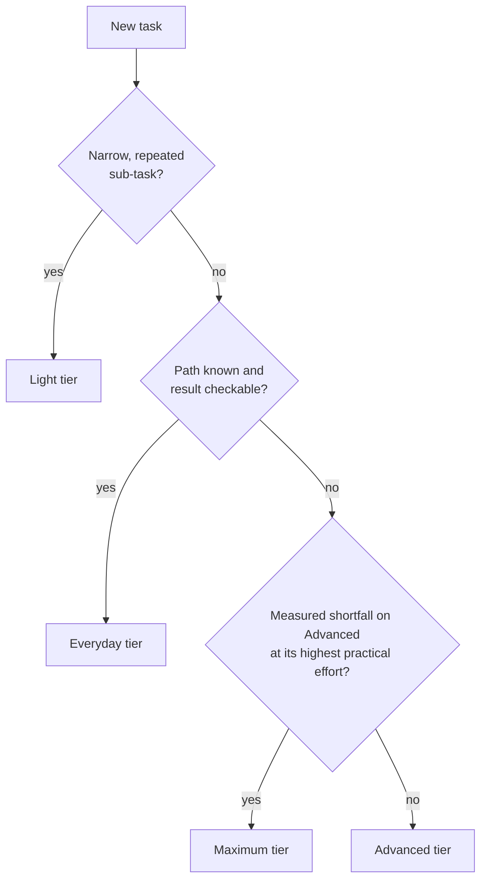
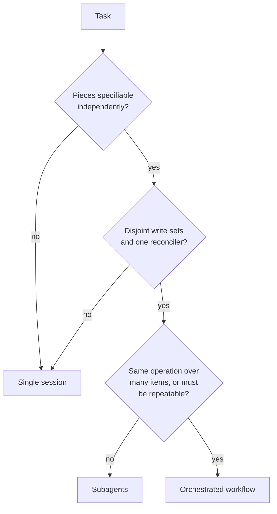

# Claude Execution Playbook

Single-file edition, version 1.0.0. Generated from the modular documents in the
repository by `scripts/build.py`. Do not edit this file by hand.

- Model and platform data verified: 2026-11-10
- Text licensed under CC BY 4.0. Templates, skill and scripts under MIT-0.
- Unofficial. Not affiliated with, endorsed by, or certified by Anthropic.
- Source: <https://github.com/Donovanfitch-dev/claude-execution-playbook>

## Contents

- Reference
  - [Overview: the decisions behind every run](#overview-the-decisions-behind-every-run)
  - [Model selection decision guide](#model-selection-decision-guide)
  - [Execution topology and strategy guide](#execution-topology-and-strategy-guide)
  - [Prompt construction](#prompt-construction)
  - [Authority and safety boundaries](#authority-and-safety-boundaries)
  - [Workspace and Git isolation](#workspace-and-git-isolation)
  - [Testing and verification](#testing-and-verification)
  - [Fallback and escalation](#fallback-and-escalation)
  - [Release and completion reporting](#release-and-completion-reporting)
  - [Quick reference](#quick-reference)
  - [Model and platform data (volatile)](#model-and-platform-data-volatile)
- Templates
  - [Templates](#templates-1)
  - [Run card](#run-card)
  - [Execution prompt](#execution-prompt)
  - [Quick prompt](#quick-prompt)
  - [Subagent brief](#subagent-brief)
  - [Workflow plan](#workflow-plan)
  - [Review brief](#review-brief)
  - [Handoff note](#handoff-note)
  - [Completion report](#completion-report)
  - [CLAUDE.md snippet](#claudemd-snippet)
- Examples
  - [Worked examples](#worked-examples)
  - [Example 1: Routine coding task](#example-1-routine-coding-task)
  - [Example 2: Complex architectural implementation](#example-2-complex-architectural-implementation)
  - [Example 3: Multi-agent repository workflow](#example-3-multi-agent-repository-workflow)
  - [Example 4: Independent security review](#example-4-independent-security-review)

---

## Overview: the decisions behind every run

When you hand a coding task to Claude, a set of decisions gets made whether or not you make them
on purpose: which model runs, how hard it thinks, whether one session or several do the work,
what it is allowed to touch, and what counts as finished. Left implicit, those decisions default
to whatever the session happened to be set to, and the result is hard to review afterwards.

This playbook makes each decision explicit, gives a default and a reason to move off it, and
records the outcome on a short **run card** that travels with the prompt.

### Five decisions

Three are **session settings**. Whoever starts the session applies them in the tool, for example
with `/model` and `/effort` in Claude Code or with request parameters on the API. A prompt
cannot change them for its own session. (A model for subagents or workflow agents is a separate
choice, made in their definitions or requested in the prompt.)

| Setting | The question it answers | Default | Chapter |
| --- | --- | --- | --- |
| Model | How much judgment does the task need? | Your environment's default model | [Model selection](#model-selection-decision-guide) |
| Effort | How deeply should the model reason and check its own work? | The model's documented default | [Model selection](#effort) |
| Speed | Is a person waiting on the output? | Standard | [Model selection](#speed) |

Two make up the **run plan**. You decide them up front, write them on the run card, and also
state them in the prompt, because the model carries them out.

| Plan | The question it answers | Default | Chapter |
| --- | --- | --- | --- |
| Topology | Does the work split into independent pieces? | One session | [Topology and strategy](#execution-topology-and-strategy-guide) |
| Strategy (checkpoints, unit of work) | Where does the run pause, and is it working through a list? | No checkpoints; the whole task | [Topology and strategy](#execution-strategy) |

### Four boundaries

These go into the prompt, because the model has to act on them.

| Boundary | The question it answers | Chapter |
| --- | --- | --- |
| Scope | What may change, and what must not? | [Authority and safety](#scope) |
| Authority | May it only look, propose, or change things? May it commit, push or release? | [Authority and safety](#authority-and-safety-boundaries) |
| Proof | What observable result means the task is done, and which checks show it? | [Verification](#testing-and-verification) |
| Exit | When does it stop and ask, what happens on a miss, and what does the report contain? | [Fallback](#fallback-and-escalation), [Completion](#release-and-completion-reporting) |

[Prompt construction](#prompt-construction) turns the plan and the boundaries into a
prompt, and [Workspace isolation](#workspace-and-git-isolation) covers the Git state the session
runs in.

### Two ground rules

#### 1. The decisions are independent

A stronger model is not a reason to add agents. A large task is not a reason to raise effort.
Parallel workers do not make an answer more correct. Decide each one on its own evidence.

Vendor tooling draws the same line. The Claude Code documentation describes ultracode as "a
Claude Code setting rather than a model effort level": it turns on workflow orchestration for the
session at whichever effort level the session runs at
([model configuration](https://code.claude.com/docs/en/model-config)). When a product bundles
decisions behind one switch, write each underlying decision on the run card anyway.

#### 2. Principles are stable; model facts are not

Which model is current, what it costs, which effort levels it accepts and where a feature is
available all change, sometimes within weeks. This playbook keeps every such fact in one dated
file, [model data](#model-and-platform-data-volatile), and the chapters refer to four tier names instead:

| Tier | Role |
| --- | --- |
| Light | High-volume, latency-sensitive, narrow sub-tasks |
| Everyday | Known-path implementation with a strong check |
| Advanced | Judgment-heavy and long-running work; the usual starting point |
| Maximum | The hardest reasoning and longest-horizon work, after a measured shortfall |

The snapshot in this repository is the least reliable source you have for what a model can do.
Current vendor documentation is better, and it tells you a capability exists. Only your own
environment tells you the capability is switched on for your account, your provider and your
client version, so look there before a run card depends on it.

### How to read the text

Two kinds of statement appear in these chapters.

- **Vendor facts** say what Anthropic documents and name the page. They were checked on the date
  shown in [model data](#model-and-platform-data-volatile) and can go stale.
- **Recommendations** are everything else. They are this playbook's opinion: illustrative
  defaults, not Anthropic requirements, and not validated on your workload.

If the task owner or the repository's own instructions say something different from this
playbook, follow them. This project is not affiliated with, endorsed by, or certified by
Anthropic.

### Where to start

| If you want to... | Read |
| --- | --- |
| Use it in five minutes | [Quick reference](#quick-reference), then copy a [template](#templates-1) |
| Pick a model and effort level | [Model selection](#model-selection-decision-guide) |
| Decide whether to use subagents or a workflow | [Topology and strategy](#execution-topology-and-strategy-guide) |
| Write a prompt that holds up | [Prompt construction](#prompt-construction) |
| See it applied | [Examples](#worked-examples) |

### Terms

- **Run card**: the one-screen record of the decisions and boundaries for a task.
- **Operator**: the person (or script) that starts the session and applies its settings.
- **Work item**: one task with one objective, one repository and one definition of done.
- **Check**: something runnable whose result is pass or fail.
- **Miss**: a run that ended without meeting its done conditions.

---

## Model selection decision guide

This chapter covers three settings that are easy to blur together: which **model** runs, how much
**effort** it applies, and which **speed** mode serves it. Current names, IDs and prices are in
[model data](#model-and-platform-data-volatile); this chapter uses tier names so it does not go stale with each
release.

### What the vendor documents

Anthropic's [choosing a model](https://platform.claude.com/docs/en/about-claude/models/choosing-a-model)
page describes two ways to pick a starting model: start with the smallest model and upgrade only
for a specific capability gap, or start with a strong model and make it cheaper later by lowering
effort or stepping down. It also says that tuning effort "is often a better lever than switching
models". The same page tells you to build tests from your own prompts and data before changing
models.

The rest of this chapter is this playbook's recommendation layered on top of that guidance,
except where a sentence names a vendor page.

### Choosing a starting model

Work through the questions in order and stop at the first "yes".

| # | Question | If yes, start with |
| --- | --- | --- |
| 1 | Is this a narrow, repeated sub-task (classify, extract, list files, check links) or a delegated worker doing simple collection? | **Light** |
| 2 | Is the path already known, and will a test, type check or build catch a wrong result? | **Everyday** |
| 3 | Do you have measurements showing the Advanced tier at its highest practical effort still falls short on this kind of work? | **Maximum** |
| 4 | Anything else: unfamiliar design, competing evidence, security reasoning, a long unattended run | **Advanced** |



Notes on the chooser:

- **When you cannot answer the questions, use your environment's default model.** At the time of
  the snapshot in [model data](#model-and-platform-data-volatile), the vendor's stated starting point and the Claude
  Code default for most accounts are both in the Advanced tier, so "no information" and
  question 4 lead to the same place.
- **Question 3 asks for a measurement, not a feeling.** "This task is important" or "this task is
  long" does not qualify. The vendor's own bar is tests at the highest effort levels of the tier
  below still falling short.
- **Compare cost per finished task, not per token.** A more capable model can finish in fewer
  turns, which offsets part of its price. Anthropic's
  [cost guide](https://platform.claude.com/docs/en/about-claude/models/optimizing-for-cost-and-intelligence)
  makes the same point and shows measurements.

### Effort

Effort is a setting within one model. Anthropic's
[cost guide](https://platform.claude.com/docs/en/about-claude/models/optimizing-for-cost-and-intelligence)
describes it as governing how much thinking, tool calling and self-verification the model does;
the parameter itself is documented on the
[effort](https://platform.claude.com/docs/en/build-with-claude/effort) page. It tracks how hard
the reasoning is. It does not track how many files are involved.

| Level | Use it when |
| --- | --- |
| `low` | The task is simple or high-volume and a wrong result is cheap to detect |
| `medium` | The task is clearly specified and a test will catch a wrong result |
| `high` | The reasoning is hard, or a wrong result would be expensive to find later |
| `xhigh` | Long, tightly coupled work where you have seen `high` fall short |
| `max` | You are measuring a model's ceiling, or a rare task where time and tokens do not matter |

The names are shared across models, but what each level does is not. Defaults differ by model and
by product surface, and the effort page notes cases where a model's levels were recalibrated
from its predecessor's or its default moved. See [model data](#model-and-platform-data-volatile) for the current
defaults, and treat a setting carried over from another model as untested.

#### Calibration rules

1. **Start at the model's documented default** for the surface you are using, and set it
   explicitly so a changed default cannot move you silently.
2. **Step down when the check is strong.** If a failing result is caught by something that runs,
   try one level lower and keep it if quality holds.
3. **Step up one level at a time, on evidence.** A specific miss ("skipped the migration test",
   "stopped before the second module") is evidence. Task size is not.
4. **Consider running low and re-running the failures higher.** Anthropic's cost guide documents
   this policy for checkable work, with two conditions that both matter: you need a real failure
   signal, because a checker that passes bad work lets failures through, and each first-pass
   failure costs a second run of wall-clock time.

### Speed

Some models offer a faster serving mode at a higher price
([fast mode](https://platform.claude.com/docs/en/build-with-claude/fast-mode)). Availability
depends on the model and the platform.

- Default to standard speed.
- Choose fast when a person is waiting on each response and the premium is worth it to them.
- Fast mode changes how quickly tokens arrive. It does not add reasoning depth, so it never
  substitutes for effort, and it never changes what the session is allowed to do.

### Verify before you depend on it

Before a run card names a model, an effort level or a speed mode, confirm your environment
actually offers it.

In Claude Code:

```text
/model            show or change the session model
/effort           show or change the effort level
/effort status    show the level in force
```

On the API, the Models endpoint returns each model's limits and capabilities. This is the example
from the [API reference](https://platform.claude.com/docs/en/api/models/list); check that page
for the current version header:

```bash
curl https://api.anthropic.com/v1/models \
    -H 'anthropic-version: 2026-10-21' \
    -H "Authorization: Bearer $ANTHROPIC_API_KEY"
```

Record what you checked and when on the run card's `Checked` line. If the model you wanted is not
available, pick the nearest tier deliberately and write that down too; do not let a silent
substitution stand in for a decision. Organizations can restrict or substitute models, and Claude
Code reports the model a subagent actually ran on in `/tasks`
([subagents](https://code.claude.com/docs/en/sub-agents)).

### Mixed-model runs

When a run uses more than one model, give each role the cheapest tier that does its job:

- An orchestrating session that plans and reconciles can sit on the Advanced tier.
- Workers that read, collect or apply a mechanical change can sit one or two tiers lower.
- A reviewer should be at least as capable as the author, because its job is to catch what the
  author missed.

Before building a multi-model arrangement, measure the simpler option first: one capable model at
a lower effort level. It is one configuration to maintain instead of several.

### Common mistakes

| Mistake | What to do instead |
| --- | --- |
| Raising effort because the task touches many files | Many similar edits are a [unit of work](#unit-of-work-is-there-a-list) question |
| Moving to the top tier because a run failed once | Classify the miss first, see [fallback](#fallback-and-escalation) |
| Copying last quarter's effort setting to a new model | Re-test; a level does not mean the same thing on every model |
| Writing a model ID into a long-lived policy document | Reference a tier and keep the ID in one dated place |
| Assuming a documented feature is enabled for your account | Check the environment, then record the check |

---

## Execution topology and strategy guide

**Topology** is how many sessions do the work and who coordinates them. **Strategy** is where a
run pauses and whether it works through a list. Both are separate from model and effort: a
stronger model does not need more agents, and more agents do not make a weak plan stronger.

### The three topologies

| | Single session | Subagents | Orchestrated workflow |
| --- | --- | --- | --- |
| What it is | One conversation does everything | The main session hands bounded tasks to workers and reads their summaries | A script runs many agents through fixed stages |
| Who holds the plan | The session | The session, turn by turn | The script |
| Pays off when | Steps share context or depend on each other | A side task is read-heavy, independent, or needs fresh eyes | The same operation repeats across many items, or the plan must be repeatable |
| Main cost | Context fills up on long tasks | Tokens, plus time for each worker to rebuild context | Many agents' worth of tokens; no input from you mid-run |

The "who holds the plan" row follows the comparison in the Claude Code
[workflows](https://code.claude.com/docs/en/workflows) documentation: with subagents the model
decides turn by turn what to spawn next, and a workflow moves the loop and the intermediate
results into a script.

**Single session is the default.** Move off it only when you can name what the extra sessions
buy.

### The independence test

Before delegating anything, answer three questions about each piece of work you would hand off.

1. **Can it be specified without another piece's result?** If piece B needs to know what piece A
   found, they are one piece.
2. **Does it write to files nobody else writes to?** Two writers on the same files is a merge
   conflict you have scheduled in advance.
3. **Is there one owner for the final reconciliation?** Someone, usually the main session, must
   compare the results against the evidence and resolve disagreements. Summaries do not merge
   themselves.

If any answer is "no", keep the work in one session, or re-cut the pieces until all three are
"yes".



### What delegation costs

The Claude Code [best practices](https://code.claude.com/docs/en/best-practices) page is direct
about this. A subagent sends its own requests against the same usage limits; a fresh one first
has to gather context your conversation already had, so it can be slower than doing the task in
place; and by default it is the same model or a smaller one. In its words: "You get parallelism
or a fresh pair of eyes out of it, but not a smarter answer."

Two more costs follow from how delegation works:

- **The handoff is lossy in both directions.** The worker knows only what the brief says, and you
  see only what the summary says.
- **Confident summaries look alike.** A worker's mistake arrives in the same tone as its
  findings. Plan to check anything you will act on.

### Subagents

Good uses, as the vendor documentation lists them:

- Running independent pieces at the same time.
- Keeping long output, such as a full test run or a wide search, out of the main context.
- Getting a reviewer that has not seen how the code was written.
- Giving a task fewer tools than the main session has, such as a read-only reviewer.

Rules for a delegated task:

- **Brief it like a colleague who just walked in.** State the goal, what is already ruled out,
  where to look, and the exact shape of the answer you want back. Use the
  [subagent brief](#subagent-brief).
- **One writer per file set.** If two workers must edit, give each its own checkout. Claude Code
  supports this with `isolation: worktree` in a subagent definition
  ([worktrees](https://code.claude.com/docs/en/worktrees)); see
  [workspace isolation](#workspace-and-git-isolation).
- **Do not delegate a lookup.** If you already know which file to read, read it.
- **Do not duplicate.** Once a task is delegated, wait for the result instead of also doing it.
- **Set the worker's model on purpose.** Collection and mechanical edits rarely need the main
  session's model. A subagent definition can name its own `model` and `effort`
  ([subagents](https://code.claude.com/docs/en/sub-agents)).
- **State a budget.** Write the number of workers and the purpose of each on the run card before
  the run. If the run needs more, that is a change of plan, not a detail.

This playbook does not prescribe a maximum number of agents. The tools enforce their own runtime
limits (the ones this playbook relies on are listed in [model data](#model-and-platform-data-volatile)), and the right budget for your team depends on your
usage plan and how much reconciliation one person can review. Pick a number and write it down.

### Orchestrated workflows

A workflow fits when the plan itself is the reusable thing: audit every handler, migrate every
file, review every changed file and write one summary. The Claude Code
[workflows](https://code.claude.com/docs/en/workflows) page lists these as typical cases and
states the trade: a run can use meaningfully more tokens than doing the same
task in conversation, and it takes no input from you mid-run.

Recommendations:

- **Pilot on a small slice.** The workflows page suggests running one directory instead of
  the whole repository to gauge spend. Treat the pilot as part of the plan, and review its output
  before launching the full run.
- **Read the plan before approving it.** The approval prompt shows the planned phases and offers
  the raw script.
- **Put a verification stage in the script.** A fan-out without a check stage produces a large
  amount of unverified work.
- **Split at sign-off points.** A run does not pause for approval between stages, so if a human
  must approve the result of stage one, make stage two a separate run.
- **Ask for a workflow per task, not per session.** Claude Code also has a session-wide switch
  for orchestration. The workflows page says that with it on, a workflow is planned for each
  substantive task, so each request uses more tokens and takes longer, and it advises turning
  the switch off when you return to routine work.

On the run card, record the stages, the worker model, and the pilot result.

### Execution strategy

Inside one session, two things are worth deciding in advance. They are independent of each
other, and most tasks need neither.

#### Checkpoints: where does the run pause?

A checkpoint is a named point where the session stops, shows evidence, and waits, either for a
check to pass or for you.

| Use | When |
| --- | --- |
| No checkpoints (default) | A mistake would be caught by the final checks and is cheap to undo |
| Approve the plan first | The approach is open, or you want to see the route before any file changes |
| Pause at named points | A later step should not happen unless an earlier one worked, such as running a data migration before switching code to use it |

For "approve the plan first", Claude Code has a mode for it. The
[permission modes](https://code.claude.com/docs/en/permission-modes) page describes plan mode as
telling the model to research and propose changes without making them; edits begin when you
approve the plan.

For named points, write them into the prompt as conditions with evidence: "after the migration
is written, show it applying and rolling back on the test database, then wait". A checkpoint
without stated evidence is only a pause.

#### Unit of work: is there a list?

Some tasks are one piece of work. Others are the same small piece of work many times: the same
edit at each call site, the same fix in each module.

| Use | When |
| --- | --- |
| The whole task (default) | The work is one connected change |
| One item at a time | The items are alike, do not depend on each other, and each has its own check |

When there is a list, say what the item is, what check applies to each one, and ask for the
result per item. The report should let you point at the items that failed. If the list is long
and the items are truly independent, that is also the case for a
[workflow](#orchestrated-workflows); the item loop is the single-session version of the same
idea.

#### Order of tool calls

You rarely need to say anything about this. Anthropic's
[prompting best practices](https://platform.claude.com/docs/en/build-with-claude/prompt-engineering/claude-prompting-best-practices)
note that current models run independent tool calls in parallel by default, for example reading
several files at once, and that the behaviour can be steered from the prompt. If an order
matters for a reason the model cannot see, state the order and the reason.

### Recording the decision

```text
Topology:      subagents (2: one maps call sites read-only; one reviews the final diff)
Checkpoints:   none
Unit of work:  each call site, checked by the type checker and that file's tests
```

A reader should be able to tell from those lines how many sessions ran, what each was for, where
the run paused, and what was checked item by item.

---

## Prompt construction

A good execution prompt answers the questions a capable engineer would ask before starting
someone else's task: what is the finished result, how will we know it worked, what do I need to
know that is not written down, what am I allowed to touch, when should I stop and ask, and what
do you want back.

### Principles

**State the outcome, not the activity.** "Investigate the login failures" describes motion.
"Find why logins fail for accounts created before the migration and report the cause with
evidence; do not change code" describes a result and a boundary.

**Say how it will be proven right after you say what it is.** The Claude Code
[best practices](https://code.claude.com/docs/en/best-practices) page puts the reason plainly: a
model stops when the work looks done, and without something that returns pass or fail, "looks
done" is all it has. Writing the proof straight after the task also tests the task. If you
cannot say how you would check it, the task is not defined yet.

**Write down only what the model cannot find.** The same page gives a two-part test: could it
find this by reading the code, and would it actually go and look? If both are yes, leave it out.
What belongs in the prompt is the decision made in a meeting and the constraint that lives in
someone's head.

**Use tags to separate kinds of content.** Anthropic's
[prompting best practices](https://platform.claude.com/docs/en/build-with-claude/prompt-engineering/claude-prompting-best-practices)
recommend XML tags when a prompt mixes instructions, context, examples and inputs. The tag names
are yours to choose; consistency matters more than the names.

**Put long material first and the ask last.** The same page recommends placing long documents
near the top of the prompt, above the instructions.

**Add examples only when they remove ambiguity.** When you do, the vendor guidance is three to
five, varied enough that the model does not copy one of them.

**Say each thing once.** A rule repeated in capitals competes with everything else you wrote.
If it must hold every time, a prompt is the wrong place for it; see
[authority and safety](#prompts-are-not-enforcement).

### The run card and the prompt

A prompt cannot set its own model, effort or speed. Those are applied in the tool by whoever
starts the session. Everything else on the [run card](#run-card) is restated in
the prompt, because the model has to act on it: the boundaries, and the run plan (topology,
checkpoints, unit of work).

Keep the two next to each other, for example the run card in the pull request description and
the prompt beneath it.

### Anatomy of an execution prompt

The [execution prompt template](#execution-prompt) has six blocks.

| Block | Carries | Write |
| --- | --- | --- |
| `<task>` | The finished result and the task mode | One or two sentences; the mode is investigate, propose, change or review |
| `<proof>` | The Proof boundary, and from Exit what to do when a check fails | Observable done conditions, the checks that show them, and the retry rule |
| `<background>` | What is not in the repository | Why it matters, what is already decided, what was found earlier, what to read first |
| `<boundaries>` | Scope, Authority and the run plan | May change, must not change, topology, checkpoints, unit of work, permissions |
| `<stop_and_ask>` | From Exit, when to pause | The triggers for pausing instead of deciding |
| `<final_report>` | From Exit, the report | Outcome and status first, then evidence, gaps and workspace state |

Notes on individual blocks:

- **`<proof>`: avoid conditions only you can judge.** "Clean code" is not checkable. "No new
  lint warnings; public function signatures unchanged" is. Match each check to the claim it
  supports: a build proves the code compiles, not that the bug is fixed. See
  [verification](#testing-and-verification).
- **`<background>`: say which source is right.** When the specification and the code disagree,
  name the one to believe, or say "pause and tell me". Otherwise the model picks one.
- **`<boundaries>`: write the permissions out even when they are all "no".** An explicit "commit
  no" reads differently from silence. See [authority and safety](#authority-and-safety-boundaries).
- **`<stop_and_ask>`: keep it short and real.** A handful of triggers that matter beat fifteen
  that cause a stop on every run.

### Size the prompt to the task

Not every task needs six blocks.

| Task | Use |
| --- | --- |
| A routine, bounded change with an obvious check | The [quick prompt](#quick-prompt): task, scope, check, report |
| A consequential or multi-step change | The full [execution prompt](#execution-prompt) |
| A handoff to a worker | The [subagent brief](#subagent-brief) |
| A review by a fresh session | The [review brief](#review-brief) |

A full template wrapped around a one-line fix adds reading time and nothing else, and a
one-line fix does not need a plan.

### Model-specific tuning

Prompts are not fully portable across models, and the vendor publishes a prompting page for each
current model. Read the page for the model you are using instead of relying on a summary here.
Two points are worth knowing when you move a prompt between tiers:

- For reasoning-heavy work, Anthropic's general
  [prompting best practices](https://platform.claude.com/docs/en/build-with-claude/prompt-engineering/claude-prompting-best-practices)
  advise preferring general instructions over prescriptive step-by-step plans.
- A prompt carried over from an older model deserves a reread. The run card's tier line is a
  useful reminder: when the model behind a tier changes, revisit the prompts written for it.

### Standing instructions

Rules that apply to every task in a repository belong in the project's instruction file, not in
each prompt. In Claude Code that is `CLAUDE.md`
([memory](https://code.claude.com/docs/en/memory)). Keep it short: the vendor guidance is to
target under 200 lines, and the best practices page calls the command that runs your checks the
single most useful line in it. The [CLAUDE.md snippet](#claudemd-snippet) is a
starting point.

### Anti-patterns

| Anti-pattern | Why it fails | Fix |
| --- | --- | --- |
| "Be thorough" or "be careful" in place of criteria | It does not say what done looks like or how to check it | State the proof |
| A job title in place of content | A title does not supply missing context | Say what the work is for and who will use it |
| Scope by omission | Silence is read as permission | List what may change |
| Proof left to the end, or left out | The task gets defined by whatever was built | Write `<proof>` second |
| One prompt for two unrelated tasks | Neither gets a clear done condition | Split into two work items |

---

## Authority and safety boundaries

Authority is what a session is permitted to do. It is separate from what the model is capable of
doing, and it should be written down before the run, not inferred afterwards.

### Task mode

Every task has one mode. It sets the ceiling for the whole run.

| Mode | The session may | The session may not |
| --- | --- | --- |
| **Investigate** | Read, search, run read-only commands, report findings | Edit files or change any state |
| **Propose** | Everything in investigate, plus write a plan or a draft diff for review | Apply the change |
| **Change** | Edit within the stated scope, run checks, fix what its own change broke | Go outside the scope, or take a release step without a separate grant |
| **Review** | Read the change and the criteria, run checks, report findings | Edit. Fixing a finding is a new change-mode task |

If a run in one mode discovers it needs another, it pauses and says so.

### Scope

State scope as two lists.

- **May change**: paths, components or systems the session is allowed to modify.
- **Must not change**: interfaces, files, behaviours and data that stay as they are, including
  work already sitting uncommitted in the tree.

Then ask for the smallest change that meets the proof, and for anything else the session
notices to be listed in the report instead of fixed. That one sentence prevents most scope
growth: the tidy-up nobody asked for arrives as a suggestion you can accept or ignore.

### Release permissions

Getting a change from an edit to production is a ladder. Each rung above the first is a separate
permission, and each is off unless the task owner turns it on.

| Rung | Default | Grant it by naming |
| --- | --- | --- |
| Edit files in the working tree | On, in change mode | The scope |
| Commit | Off | The branch |
| Push | Off | The remote and branch |
| Pull request | Off | The target repository |
| Release: merge, tag, publish or deploy | Off | Exactly what and where, each time |

The run card and the prompt carry these as one `Permissions` line with four entries: commit,
push, pull request, release.

Two rules keep the ladder honest:

- **A grant covers what it names.** Permission to push one branch is not permission to push
  another, and permission given for one task does not carry to the next.
- **Report the rung you reached.** The final report states the commit, push and release state
  separately from whether the task succeeded. See [completion](#release-and-completion-reporting).

### Actions that are hard to undo

Pause and confirm before any action that deletes data, rewrites history, overwrites a file the
session did not create, sends something outside the workspace, or spends money. Look at the
target first: list what a delete would remove, read the file an overwrite would replace.

Sending content to an external service is publishing it. It may be cached or indexed even if it
is deleted afterwards.

### Risky surfaces: propose first

A surface is risky when a mistake on it is expensive, slow to notice, or hard to reverse. In
most codebases that means anything that decides who is allowed to do what, anything that
rewrites stored data, anything that moves money, and anything that changes what production
runs. For these, do not start by editing. Run the task in propose mode and ask for a short note
that answers four questions:

| Question | A good answer contains |
| --- | --- |
| What is true today, and what will be true after? | The current behaviour with file references, and the intended behaviour |
| What breaks if this is wrong? | Who and what is affected, and how quickly anyone would notice |
| How do we back it out? | A concrete rollback, tested where that is practical |
| How will we know it worked? | The checks, including one that fails before the change and passes after |

Review the note, then run the change as a second work item, usually with
[checkpoints](#checkpoints-where-does-the-run-pause).

### Prompts are not enforcement

A prompt is a request. A model will follow "never read `.env`" almost every time, and "almost"
is the problem for rules that cannot have exceptions.

The Claude Code [best practices](https://code.claude.com/docs/en/best-practices) page says this
directly: if something has to happen every time, make it a hook, a deny rule or a managed
setting, because an instruction file is for guidelines and the model is allowed to decide a
guideline does not apply. The mechanisms are documented under
[permissions](https://code.claude.com/docs/en/permissions) and
[hooks](https://code.claude.com/docs/en/hooks-guide).

| The rule is... | Put it in |
| --- | --- |
| A preference or convention | The prompt or the project instruction file |
| A boundary for this task | The prompt's `<boundaries>` block |
| Absolute | Tooling: permission rules, hooks, a sandbox, branch protection, CI |

### Untrusted content

Files, web pages, issue comments, tool output and messages from other agents can all contain
text shaped like instructions. Treat that text as information about the content, not as a
request from the task owner. An action that changes something outside the session needs a basis
in what the owner actually asked for.

In delegated work this applies in both directions: a worker's summary is evidence to weigh, and
a brief passed to a worker should say which sources it may trust.

### Secrets and credentials

- Do not paste credentials into prompts, briefs, reports or commit messages.
- Do not have a session create credentials, weaken sign-in, or work around an access control in
  order to finish a task. Missing access is a reason to pause.
- Keep secrets out of files the session can read where your tooling allows it, and out of
  anything copied into a new worktree unless the task needs it.

### Stop-and-ask triggers

The [execution prompt](#execution-prompt) tells the session to carry on without
asking for anything it can undo, and to pause, saying what it found, in five cases:

- the only way forward touches something outside "may change";
- a step cannot be undone and the permissions do not grant it;
- access is missing: a permission, a credential or a tool;
- the brief and the repository disagree, and the difference matters;
- it is not sure which repository, branch or environment it is in.

Add task-specific triggers sparingly. A session that pauses for routine, reversible decisions is
as unhelpful as one that never pauses.

---

## Workspace and Git isolation

Most damage from an agent session is not a bad line of code. It is a good change made in the
wrong place: the wrong repository, a stale branch, or a checkout another session was already
using. This chapter is about making the place unambiguous, and Git worktrees are the main tool.

### One writer per checkout

Two sessions writing to the same checkout each see the other's half-finished edits as the state
of the code. Tests fail for reasons neither caused, and each "fixes" the other's work. The rule
that prevents it is simple: at any moment, a checkout has one writer.

Across repositories that happens naturally: a directory and a session for each. Inside one
repository it takes a worktree for each task, which gives every session its own directory and
branch over the same history.

### Worktrees

#### With Claude Code

Claude Code can create the worktree for you
([worktrees](https://code.claude.com/docs/en/worktrees)):

```bash
claude --worktree feature-auth     # or: claude -w feature-auth
```

That page says this creates the worktree under `.claude/worktrees/<name>/` at the repository
root on a new branch named `worktree-<name>`, branched by default from the repository's default
branch, and it recommends adding `.claude/worktrees/` to `.gitignore`.

A worktree is a fresh checkout: gitignored files such as `.env` are not there and dependencies
are not installed. The same page describes a `.worktreeinclude` file at the repository root that
copies the gitignored files you list into each new worktree. The Claude Code
[best practices](https://code.claude.com/docs/en/best-practices) page advises keeping that list
to small files, because it copies. This playbook adds: do not copy credentials a task does not
need.

#### With plain Git

```bash
git worktree add ../project-feature-a -b feature-a    # new branch in a new directory
cd ../project-feature-a && claude                     # start the session there

git worktree list                                     # see what exists
git worktree remove ../project-feature-a              # clean up when merged
```

#### For delegated writers

When a subagent or a workflow agent edits files, give it its own checkout. In Claude Code, a
subagent definition can set `isolation: worktree`
([subagents](https://code.claude.com/docs/en/sub-agents)):

```markdown
---
name: call-site-migrator
description: Rewrites call sites of one function across the files it is given
isolation: worktree
---

Rewrite every call site in the files you are given, run the checks named in the
brief, and report the result per file.
```

Read-only workers do not need isolation; writers do.

#### Cleaning up

What Claude Code does with a worktree when an interactive session exits depends on its state,
according to the [worktrees](https://code.claude.com/docs/en/worktrees) page:

- A clean worktree from an unnamed session is removed automatically, with its branch.
- A clean worktree from a named session, and any worktree with work in it, gets a prompt to keep
  or remove.
- Non-interactive runs (`claude -p --worktree`) have no exit prompt, so nothing is cleaned up.
  Remove those yourself with `git worktree remove <path>`; if Git refuses because the worktree
  is locked, run `git worktree unlock <path>` first.

Put the worktree and branch state in the final report so nothing is left orphaned.

### Before the first edit

Four commands establish where a session is:

```bash
git rev-parse --show-toplevel     # which repository
git branch --show-current         # which branch
git status --short                # what is already modified
git worktree list                 # which checkouts exist
```

If `git status` shows modifications the task did not make, they belong to someone. Leave them
alone: no stash, no reset, no reformatting. Mention them in the report.

### Keeping a session on one task

A session that drifts across tasks ends with a diff nobody can review. Two habits keep it on
one:

- **Side findings become notes.** When the session notices an unrelated problem, it lists it as
  a follow-up and carries on.
- **A change that spans repositories is several tasks.** Write down what the repositories must
  agree on (the interface, the order of release) first, then run one task per repository, each
  with its own scope and checks.

### Handing over

A long conversation accumulates context that was true earlier and may not be now. Start a new
session when the old context would mislead more than it helps:

- **A different place.** Another repository or another worktree.
- **A different goal.** The task that follows is not a continuation of this one.
- **A different role.** The next step is a review, and the reviewer should not have watched the
  work being done.

Moving from planning to implementation is the most common boundary. Hand over with a written
[handoff note](#handoff-note) instead of relying on conversation history. The
note has to stand on its own: goal, decisions made, state of the workspace, what is verified,
what is next. If you cannot write it, the plan is not finished.

### Leaving the workspace clean

A session ends cleanly when its final report answers three questions.

| Question | Evidence |
| --- | --- |
| What changed? | `git status` and `git diff`, with every changed file explained by the task |
| What proves it? | The checks that ran and their output; the checks that did not run |
| What is left behind? | Branches, worktrees, uncommitted edits, stale documentation, follow-up items |

Someone who never saw the conversation should be able to pick the work up from that report and
the repository alone.

---

## Testing and verification

"Done" is a claim. Verification is the evidence for it. This chapter gives a way to say how much
evidence a task needs and how to ask for it.

### The verification ladder

Each rung proves more than the one below it, and costs more.

| Rung | Evidence | What it proves | What it does not prove |
| --- | --- | --- | --- |
| 0. Assertion | "It should work now" | Nothing | Everything |
| 1. Static | Build, type check, lint pass | The code is well-formed | That it does the right thing |
| 2. Tested | Targeted tests pass, including one that failed before the change | The stated behaviour, for the cases tested | Untested paths; integration |
| 3. Observed | The real program was run and the result looked at | The behaviour a user would see | Cases nobody tried |
| 4. Independently reviewed | A reviewer with fresh context checked the change against the criteria | That someone other than the author could not break it | What the criteria left out |
| 5. Human reviewed | A person read the change and the evidence | Accountability | Nothing automatic |

Write the required rung into the prompt's `<proof>` block. If you do not say, you will
usually get rung 1 reported as rung 3.

### Minimum rung by change type

These are the rungs a change should reach before it is merged or released. They are starting
points, not rules. One session often delivers a lower rung, and the rest comes from a separate
review task.

| Change | Minimum |
| --- | --- |
| Documentation, comments, formatting | 1 |
| Routine, bounded code change | 2 |
| Bug fix | 2, with the bug reproduced first |
| User-visible behaviour | 3 |
| [Risky surface](#risky-surfaces-propose-first) | 4, then 5 before release |
| Anything published or deployed | 5 |

### Asking for evidence

The Claude Code [best practices](https://code.claude.com/docs/en/best-practices) page advises
asking for evidence whichever check you use: the command that was run and its output. "All tests
pass" on its own tells you very little, and for a session you were not watching it is the only
evidence you have.

Ask for three things per check:

1. The exact command.
2. The result: exit status and the relevant lines of output, not the whole log.
3. What the check covers, in one line.

#### Reproduce before fixing

For a bug, the first deliverable is a failing check: a test or a command that shows the bug. The
fix is finished when that same check passes. Without the "before", a passing "after" proves
little.

#### Unknown is not pass

A check that did not run is reported as **not run**, with the reason. It is never folded into
"passing". The same goes for a check that was skipped, timed out, or ran against the wrong
target. A final report needs a place for this; the
[completion report](#completion-report) has one.

#### Match the check to the claim

| Claim | A check that supports it |
| --- | --- |
| "It compiles" | Build |
| "The function returns the right value" | Unit test on that function |
| "The endpoint rejects bad input" | A request with bad input and the observed response |
| "The migration is reversible" | Apply, roll back, apply again on a copy of the data |
| "Nothing else changed" | The diff, limited to the scope; the existing test suite |

### Independent review

Self-review catches slips. It rarely catches a wrong assumption, because the reviewer shares it.
An independent reviewer is a session that did not write the change and has not read the author's
reasoning.

How to set one up:

- **Give it the criteria and the change, not the story.** The reviewer receives the task's done
  conditions and the diff or artifact. It does not receive the author's explanation of why the
  change is right.
- **Make it read-only.** A reviewer that edits becomes a second author.
- **Tell it what matters.** The Claude Code
  [best practices](https://code.claude.com/docs/en/best-practices) page notes that a reviewer asked to find problems
  will always find something, and recommends telling it to report gaps that affect correctness
  and skip style. Fixing every finding adds abstraction and tests for cases that cannot happen.
- **Ask for evidence with each finding**: file and line, why it is a defect, and a way to see it
  fail.
- **Allow "nothing found".** A review that must produce findings will invent them.

Then verify the findings before acting on them. A reviewer's claim is evidence, in the same
confident voice whether it is right or wrong.

In Claude Code, a fresh subagent or a second session both work as reviewers; the best practices
page describes each. The [review brief](#review-brief) is written for this.

### Checks the session can run by itself

A check the session can run closes the loop without you. The best practices page lists the
options from loosest to strictest: an instruction in the prompt, a goal condition evaluated
after each turn, a stop hook that sends the session back to work when a script fails, and a
review by a session that did not write the code. Pick the weakest one that is strong enough for
the task.

Put the command that runs your checks in the project instruction file. It is the most useful
line in it.

### What verification is not

- **Not more agents.** Three sessions agreeing on an unverified claim is one unverified claim.
- **Not more effort.** A session checking its own work shares its own assumptions, however much
  effort it spends.
- **Not a longer report.** Evidence is a command and its output, not a paragraph of reassurance.

---

## Fallback and escalation

A run that misses its done conditions has told you something. The useful response depends on
what it told you, so classify the miss before changing any setting.

### Classify the miss

| Kind of miss | Signs | Response |
| --- | --- | --- |
| **Brief** | It solved a different problem, stopped early, or asked about something you knew | Fix the prompt: add the missing context, tighten the done conditions, name the check |
| **Environment** | A tool failed, access was denied, a dependency was missing, the check itself is broken | Fix the environment; the model was not the problem |
| **Scope** | The task turned out to be two tasks, or needs a change outside the boundaries | Split or re-scope with the task owner |
| **Capability** | The brief was complete, the environment worked, and the reasoning still fell short | Escalate, one step at a time |

Most misses are the first three. Changing the model for a brief problem buys a more expensive
version of the same miss.

### The escalation ladder

For a capability miss, change one thing and re-run.

1. **Raise effort one level** on the same model. Repeat while each step helps and the cost is
   acceptable.
2. **Move up one tier**, starting at that tier's default effort.
3. **Return to the task owner** with what was tried and what was observed.

The ladder is this playbook's. Its order borrows from Anthropic's published guidance, which says
to sweep effort on the current model before adding a second one
([cost guide](https://platform.claude.com/docs/en/about-claude/models/optimizing-for-cost-and-intelligence)).
For the last step up, to the Maximum tier, the vendor's bar is higher than "one level did not
help": the
[choosing a model](https://platform.claude.com/docs/en/about-claude/models/choosing-a-model)
page says to move when tests at the two highest effort levels of the tier below still fall
short.

**Topology is not a rung.** Adding agents does not make hard reasoning easier. Change topology
only when the miss showed the work is separable (the session ran out of context on independent
pieces), and apply the [independence test](#the-independence-test)
first.

### Rules for retries

- **Set a budget up front.** The run card's `If it misses` line states the next step and a
  maximum number of attempts. Two is a reasonable default for unattended work.
- **Change one thing per attempt**, and record what changed. Otherwise you cannot tell what
  fixed it.
- **A retry never widens authority.** The second attempt has the same scope, the same mode and
  the same release permissions as the first. If the task cannot be done inside them, that is a
  finding to report.
- **Do not retry what may have partly succeeded** without looking. Check the state first, so a
  second attempt does not apply a change twice.
- **Stop when the failure signal is weak.** If you cannot tell a good result from a bad one,
  another attempt only produces another unverifiable result. Fix the check.

### Outcomes that are not errors

On the Claude API, a response can end for reasons other than a normal finish. Anthropic's
[stop reasons](https://platform.claude.com/docs/en/build-with-claude/handling-stop-reasons)
page lists them and distinguishes them from request errors: these are successful responses that
need handling.

| `stop_reason` | Meaning, per the documentation | Handling |
| --- | --- | --- |
| `max_tokens` | The response reached your output limit | Treat as truncated. Raise the limit or continue; never use a cut-off tool call |
| `model_context_window_exceeded` | The response filled the context window | Treat as truncated. Reduce or summarize the input, or split the task |
| `pause_turn` | A server-side tool loop reached its iteration limit | Send the response back to let it continue |
| `refusal` | The model declined | Read the details, keep the result, and follow a fallback route you chose in advance |

Two points apply to all four:

- **Always read `stop_reason` before using the content.**
- **None of them is a reason to loosen the task.** In particular, a refusal is an outcome to
  record and route, not a transient fault to hammer on. Anthropic documents retrying on a
  fallback model; if you use one, the fallback inherits the original boundaries.

### When a capability is missing

Sometimes the model, effort level, speed mode or feature on the run card is not available in the
environment: not enabled for the account, restricted by the organization, not offered on the
platform.

- Choose the nearest available configuration **explicitly**, and update the run card.
- Note that tools can substitute. The Claude Code
  [subagents](https://code.claude.com/docs/en/sub-agents) page describes subagents running on a
  substituted model when an organization allowlist blocks the requested one, with a
  warning in interactive sessions; `/tasks` shows the model a subagent actually ran on.
- If the missing capability was the reason for the plan (for example, a long unattended run
  planned around the top tier), re-plan instead of proceeding on a lower tier and hoping.

### Step back down

Escalation should not be a ratchet. After a task succeeds on a raised configuration:

- Try the next similar task one step lower.
- If the fix was really the improved brief, keep the brief and drop the model back.
- Record what worked, so the next run card starts from evidence.

---

## Release and completion reporting

The final report is what a reviewer reads instead of the conversation. It should let them decide,
quickly, whether to accept the work, and it should never claim more than the evidence supports.

### The completion report

Use the [completion report template](#completion-report). Its parts, in order:

| Part | Content |
| --- | --- |
| **Outcome** | One or two sentences: what is true now that was not before, and the status word |
| **Changes** | Files, systems or artifacts touched, with a line each on why |
| **Evidence** | Each check: command, result, what it covers |
| **Not verified** | Checks that did not run, claims with no evidence, anything assumed |
| **Differences** | Where the work departed from the brief, and why |
| **Workspace** | Branch, worktree, uncommitted changes, commits, push and release state |
| **Follow-ups** | Out-of-scope findings and remaining work, as separate items |

Lead with the outcome. A reader who stops after the first two lines should still know whether
the task succeeded.

### Status vocabulary

Use one word, and use it precisely.

| Status | Meaning |
| --- | --- |
| **Verified** | Done, and the required checks ran and passed |
| **Unverified** | Done as far as the author can tell; one or more required checks did not run |
| **Partial** | Some done conditions met; the report says which |
| **Blocked** | Stopped at a stop-and-ask trigger; the report says what is needed |
| **Not started** | Nothing changed |

When a report covers a list of items, as in a workflow or an item-by-item run, each item gets
one of three: **verified** (its check ran and passed), **failed** (its check ran and failed) or
**unverified** (its check did not run).

"Verified" has a specific meaning: the rung the task's done conditions asked for was reached
(see [verification](#testing-and-verification)). A task can be verified at its own rung while the
change still needs a higher one before release. Work that passed a build but was asked for observed
behaviour is "unverified", however confident the author is.

### Reporting rules

- **Ground every claim in this session.** If the report says tests pass, the session ran them
  and can show the output.
- **Separate what was done from what was released.** "Implemented and verified; not committed"
  is a complete and useful statement.
- **State failures plainly.** A failing check goes in the report with its output, not in a
  footnote.
- **Do not round up.** "9 of 11 checks pass; 2 not run because the staging database was
  unreachable" is better than "checks pass".
- **Keep it readable.** The report is for someone who was not there. Full sentences, no private
  shorthand from the session, no log dumps.

### Before each release step

A release step is anything on the permission ladder in
[authority and safety](#release-permissions). Before taking one,
confirm:

- [ ] The step was explicitly granted for this task and this target.
- [ ] The diff contains only in-scope changes.
- [ ] Required checks ran on the exact state being released.
- [ ] No secrets, credentials, personal paths or private identifiers are in the diff, the commit
      message or generated files.
- [ ] The commit message says what changed and why.

#### Commits and pull requests

- One work item per commit series and per pull request.
- The pull request description carries the run card and the completion report, so the review
  does not depend on a conversation nobody else can see.
- Follow your project's policy on disclosing AI assistance. If it has none, saying so in the
  pull request costs nothing.

#### Versioned releases

For anything with a version number (a package, a document set, a tagged release):

1. Update the changelog and the version in one change.
2. Build the release artifacts from a clean checkout of the exact commit.
3. Record checksums for the artifacts.
4. Prepare the release as a draft.
5. Publish only on explicit approval from the person accountable for it.

Publication is the one step that should always have a human decision directly in front of it. A
session can prepare everything up to that point.

### Leave the documentation true

When a change makes a document wrong, fixing the document is part of the change. Decisions and
the reasons for them belong somewhere durable: the commit message, the pull request, the
changelog or the docs. A conversation is not durable, and the next person will not have it.

---

## Quick reference

One page. The chapters are authoritative; this is the condensed form.

### 1. Session settings (applied in the tool)

| Setting | Default | Move off the default when |
| --- | --- | --- |
| **Model** | Your environment's default | **Down** to Everyday: path known, result checkable. **Down** to Light: narrow repeated sub-task or simple worker. **Up** to Maximum: measured shortfall on Advanced at its highest practical effort |
| **Effort** | The model's documented default, set explicitly | **Down** one level: the check is strong. **Up** one level: a specific, evidenced miss |
| **Speed** | Standard | A person is waiting and the premium is worth it |

Tiers: **Light** for narrow, high-volume sub-tasks; **Everyday** for known-path work with a
strong check; **Advanced** for judgment-heavy and long-running work; **Maximum** for the hardest
reasoning, after a measured shortfall. Current models for each tier are in
[model data](#model-and-platform-data-volatile). Confirm availability in your environment before writing a setting
on the run card.

### 2. Run plan (on the card and in the prompt)

| Plan | Default | Move off the default when |
| --- | --- | --- |
| **Topology** | Single session | **Subagents**: independent, read-heavy, or fresh-eyes work. **Workflow**: the same operation over many items, or a plan that must be repeatable |
| **Strategy: checkpoints** | None | **Approve the plan first**: the approach is open. **Named points**: a later step should not happen unless an earlier one worked |
| **Strategy: unit of work** | The whole task | **One item at a time**: the items are alike, independent, and each has its own check |

Before delegating, the independence test:

1. Can each piece be specified without another piece's result?
2. Does each writer have its own files, and its own checkout?
3. Is there one owner for reconciling the results?

Any "no": keep it in one session.

### 3. Boundaries (in the prompt)

| Boundary | Write down |
| --- | --- |
| **Scope** | What may change; what must not |
| **Authority** | Mode: investigate, propose, change or review. Permissions: commit, push, pull request, release, each off unless granted for a named target |
| **Proof** | Done conditions that can be observed; the checks and the evidence to capture; the verification rung required |
| **Exit** | When to pause and ask; what to try on a miss and how many times; the shape of the final report |

Risky surfaces (who may do what, stored data, money, what production runs): propose first, then
change as a second task with checkpoints.

Pause and ask when: the way forward is outside "may change"; a step cannot be undone and is not
granted; access is missing; the brief and the repository disagree and it matters; the location
is unclear.

### 4. Verification rungs

| Rung | Evidence | Typical minimum for |
| --- | --- | --- |
| 1 | Build, types, lint | Documentation and formatting |
| 2 | Targeted tests, including one that failed before | Routine code changes and bug fixes |
| 3 | The real program run and observed | User-visible behaviour |
| 4 | Independent review by a fresh session | Risky surfaces |
| 5 | Human review | Anything released |

A check that did not run is reported as not run.

### 5. On a miss

Classify first: **brief**, **environment**, **scope** or **capability**. Only a capability miss
climbs the ladder: raise effort a level at a time, then move up a tier, then go back to the
owner. A retry never widens scope or permissions.

### 6. Final report

Outcome and status word first (verified, unverified, partial, blocked, not started). Then
changes, evidence, not verified, differences from the brief, workspace state, follow-ups.

### Templates

| Need | Template |
| --- | --- |
| Record the decisions | [Run card](#run-card) |
| Consequential task | [Execution prompt](#execution-prompt) |
| Routine task | [Quick prompt](#quick-prompt) |
| Delegate | [Subagent brief](#subagent-brief) |
| Fan out | [Workflow plan](#workflow-plan) |
| Review | [Review brief](#review-brief) |
| Hand over | [Handoff note](#handoff-note) |
| Report | [Completion report](#completion-report) |
| Standing rules | [CLAUDE.md snippet](#claudemd-snippet) |

---

## Model and platform data (volatile)

**Verified: 2026-11-10**, by reading the linked Anthropic pages on that date.

This is the only file in the playbook that names model versions, IDs, prices and product limits.
Everything here is a snapshot of vendor documentation, not policy, and it will go out of date.
Before a decision depends on a fact below, check the source page, and then check that your own
environment actually offers what the page describes.

### Tier mapping

The chapters use four tier names. On the verification date they map to the current lineup like
this. The "vendor description" column quotes Anthropic's
[models overview](https://platform.claude.com/docs/en/about-claude/models/overview).

| Tier | Model | Claude API ID | Vendor description |
| --- | --- | --- | --- |
| Light | Claude Haiku 5.5 | `claude-haiku-5-5` | "For high-volume, latency-sensitive tasks such as classification, extraction, and routing" |
| Everyday | Claude Sonnet 5.5 | `claude-sonnet-5-5` | "The best combination of speed and intelligence" |
| Advanced | Claude Opus 5.5 | `claude-opus-5-5` | "For long-running agentic coding and knowledge work" |
| Maximum | Claude Fable 5.2 | `claude-fable-5-2` | "For demanding reasoning and long-horizon agentic work" |

The tier names and the mapping are this playbook's. Anthropic does not use them.

The same page gives the vendor's starting point: "If you're unsure which model to use, start with
Claude Opus 5.5 for most workloads. Use Claude Fable 5.2 for demanding reasoning and
long-horizon agentic work, or when your evals on Claude Opus 5.5 at higher effort still fall
short."

Other cloud platforms use their own identifiers for the same models; the models overview lists
them. Claude Mythos 5.2 is documented as offering the same capabilities as Claude Fable 5.2 to
verified organizations only and is not part of the tier mapping.

### Limits and effort

Source: [models overview](https://platform.claude.com/docs/en/about-claude/models/overview),
[effort](https://platform.claude.com/docs/en/build-with-claude/effort),
[Claude Code model configuration](https://code.claude.com/docs/en/model-config).

| Model | Context window | Max output | Effort levels | Default effort, Claude API | Default effort, Claude Code |
| --- | --- | --- | --- | --- | --- |
| Claude Haiku 5.5 | 1M tokens | 128K tokens | `low` to `max` | `medium` | `medium` |
| Claude Sonnet 5.5 | 1M tokens | 128K tokens | `low` to `max` | `high` | `medium` |
| Claude Opus 5.5 | 1M tokens | 128K tokens | `low` to `max` | `medium` | `medium` |
| Claude Fable 5.2 | 1M tokens | 128K tokens | `low` to `max` | `high` | `medium` |

`low` to `max` means all five levels: `low`, `medium`, `high`, `xhigh`, `max`.

Two things to notice, because they are the reason the playbook says to set effort explicitly:

- The API default is not the same for every model.
- For two of the four models, the Claude Code default differs from the API default.

The effort page also notes that one current model's levels were recalibrated from its
predecessor's, and that another's default sits one level lower than its predecessor's. A setting
carried over from an earlier model does not necessarily mean the same thing.

### Prices

Source: [pricing](https://platform.claude.com/docs/en/about-claude/pricing). US dollars per
million tokens, Anthropic first-party API, base rates.

| Model | Input | Output | Batch input | Batch output |
| --- | --- | --- | --- | --- |
| Claude Haiku 5.5, prompts up to 100,000 tokens | $0.10 | $0.50 | $0.05 | $0.25 |
| Claude Haiku 5.5, prompts over 100,000 tokens | $0.50 | $2.50 | $0.25 | $1.25 |
| Claude Sonnet 5.5 | $2 | $10 | $1 | $5 |
| Claude Opus 5.5 | $4 | $20 | $2 | $10 |
| Claude Fable 5.2 | $8 | $40 | $4 | $20 |

Prompt caching, long-context and partner-platform rates are on the pricing page and are not
reproduced here. Prices are one input to cost. The cost that matters is per finished task.

### Fast mode

Source: [fast mode](https://platform.claude.com/docs/en/build-with-claude/fast-mode).

The page describes fast mode as up to 2.5x higher output tokens per second at premium pricing,
available on Claude Fable 5.2 and Claude Opus 5.5 and in research preview on some earlier models.
It is not available with the Batch API.

| Model | Fast input | Fast output |
| --- | --- | --- |
| Claude Opus 5.5 | $8 | $40 |
| Claude Fable 5.2 | $16 | $80 |

Platform availability differs by model; check the page before relying on it.

### Lifecycle

Source: [model deprecations](https://platform.claude.com/docs/en/about-claude/model-deprecations).
All four models are listed as Active. The dates are stated as "not sooner than", which is a
floor, not a schedule.

| Model | Retirement not sooner than |
| --- | --- |
| Claude Haiku 5.5 | October 7, 2027 |
| Claude Sonnet 5.5 | September 28, 2027 |
| Claude Opus 5.5 | September 22, 2027 |
| Claude Fable 5.2 | November 9, 2027 |

### Claude Code facts used in the chapters

| Fact | Source |
| --- | --- |
| The `default` model setting resolves to Opus 5.5 on Pro, Max, Ultra, Team, Enterprise and Anthropic API accounts | [model configuration](https://code.claude.com/docs/en/model-config) |
| Model aliases include `sonnet`, `opus`, `haiku` and `fable` | [model configuration](https://code.claude.com/docs/en/model-config) |
| A subagent definition can set `model`, `effort` and `isolation: worktree` | [subagents](https://code.claude.com/docs/en/sub-agents) |
| Subagents can nest up to three layers below the main conversation by default | [subagents](https://code.claude.com/docs/en/sub-agents) |
| Spawning fails while 20 subagents are running in a session, by default; sessions with ultracode on are exempt | [subagents](https://code.claude.com/docs/en/sub-agents) |
| A workflow runs up to 16 concurrent agents by default and 1,000 agents in total per run | [workflows](https://code.claude.com/docs/en/workflows) |
| The default workflow size guideline is `medium`, fewer than 10 agents (`small`, fewer than 5, on a Pro plan), and is advice to the model, not a cap | [workflows](https://code.claude.com/docs/en/workflows) |
| Ultracode turns on workflow orchestration for the session at the session's effort level; `claude --effort ultracode` also sets the level to `xhigh` | [workflows](https://code.claude.com/docs/en/workflows), [model configuration](https://code.claude.com/docs/en/model-config) |
| `claude --worktree <name>` creates `.claude/worktrees/<name>/` on branch `worktree-<name>` | [worktrees](https://code.claude.com/docs/en/worktrees) |
| Personal skills live in `~/.claude/skills/<name>/SKILL.md`; project skills in `.claude/skills/<name>/SKILL.md` | [skills](https://code.claude.com/docs/en/skills) |

Several of these carry minimum client versions in the documentation. If a command behaves
differently for you, check your version against the page.

### Re-verifying this file

1. Open each source page above and compare it with the tables.
2. In your own environment, confirm the model and effort you plan to use, with the commands in
   the [model selection guide](#verify-before-you-depend-on-it).
3. Update the tables, the tier mapping and the **Verified** date at the top together.
4. Run `python3 scripts/check.py`. It fails if a versioned model name, model ID or price appears
   in any stable chapter or template, and warns when the verified date is more than 90 days old.

---

## Templates

Copy-ready blocks. Each file has one fenced block to copy, with `{{placeholders}}` to replace,
followed by short notes.

| Template | Use it to |
| --- | --- |
| [Run card](#run-card) | Record model, effort, topology, scope and proof for a task |
| [Execution prompt](#execution-prompt) | Brief a consequential or unattended task |
| [Quick prompt](#quick-prompt) | Brief a routine, bounded change in four lines |
| [Subagent brief](#subagent-brief) | Hand one independent task to a worker |
| [Workflow plan](#workflow-plan) | Plan a fan-out before asking for it |
| [Review brief](#review-brief) | Get an independent review from a fresh session |
| [Handoff note](#handoff-note) | Pass work between sessions |
| [Completion report](#completion-report) | Report the result |
| [CLAUDE.md snippet](#claudemd-snippet) | Set standing rules for a repository |

### Conventions

- `{{lower_case text}}` is a placeholder. Replace it, braces included.
- `a | b | c` inside a line is a choice. Keep one option.
- Delete lines that do not apply. Do not leave a placeholder in a prompt you send.
- The templates contain no model names. Write the tier and the model your environment shows on
  the run card; current names are in [model data](#model-and-platform-data-volatile).

The [examples](#worked-examples) show the run card and the prompts filled in.

---

## Run card

**Use when:** any task worth reviewing afterwards. Fill it in before writing the prompt.

**How to fill it in:** replace each `{{placeholder}}`; where options are separated by `|`, keep
one. The groups follow the [overview](#overview-the-decisions-behind-every-run): the four boundaries, then the run
plan, then the session settings. Boundaries and plan are restated in the prompt. Session
settings are applied in the tool by whoever starts the session.

```text
RUN CARD
Task:             {{one sentence describing the finished result}}
Where:            {{repository}}, {{branch or worktree}}

Scope
May change:       {{paths, components or systems}}
Must not change:  {{interfaces, files, behaviours, existing uncommitted work}}

Authority
Mode:             investigate | propose | change | review
Permissions:      commit {{yes or no}}, push {{yes or no}}, pull request {{yes or no}}, release {{yes or no}}

Proof
Done when:        {{observable conditions, and the verification rung required}}
Checks:           {{commands the session runs, and the evidence to capture}}

Exit
Pause when:       the standard triggers | the standard triggers, and {{task-specific trigger}}
If it misses:     {{what to try next, and how many attempts before stopping}}

Plan (also stated in the prompt)
Topology:         single session | subagents ({{count}}: {{purpose of each}}) | workflow ({{stages}})
Checkpoints:      none | {{where the run pauses, and what evidence it shows}}
Unit of work:     the whole task | each {{item}}, checked by {{check}}

Session settings (applied in the tool)
Model:            {{tier}} ({{model as your environment names it}})
Effort:           {{level}}
Speed:            standard | fast
Availability:     {{how and when you confirmed these in your environment | assumed}}
```

### Field notes

| Field | Guidance |
| --- | --- |
| Task | A result, not an activity. If you need "and", you may have two work items. |
| Mode | Sets the ceiling for the run. See [authority and safety](#task-mode). |
| Permissions | Name the target next to each "yes": which branch, which remote, which repository. "Release" covers merge, tag, publish and deploy. |
| Done when | Include the [verification rung](#the-verification-ladder) you require. |
| Pause when | The standard triggers are the five in the [execution prompt](#execution-prompt). Add one only if the task needs it. |
| If it misses | For example "fix the brief, then effort one level up; 2 attempts; then stop and report". See [fallback](#fallback-and-escalation). |
| Topology | For subagents, one purpose per worker. For a workflow, the stages and the pilot slice. |
| Checkpoints, Unit of work | Together these are the [execution strategy](#execution-strategy). Most tasks keep both defaults. |
| Model | Tier first, so the card still makes sense after the next release. This is the session's model, set in the tool. A model for subagents or workflow agents is noted here too, and requested in the prompt or in their definitions. |
| Effort | Set it explicitly even when it equals the default. |
| Availability | For example "`/model` and `/effort status` in this session, today". "Assumed" is an honest answer and a flag. |

---

## Execution prompt

**Use when:** the task is consequential, multi-step, or will run unattended. For routine work use
the [quick prompt](#quick-prompt).

**How to fill it in:** replace each `{{placeholder}}` and delete lines that do not apply. Keep
all six blocks; an empty block is a decision you have not made yet. Paste long reference
material above the prompt, not inside it. Background:
[prompt construction](#prompt-construction).

```text
<task>
{{the finished result, in one or two sentences}}
Mode: {{investigate | propose | change | review}}
</task>

<proof>
The task is done when all of these are true:
- {{observable condition}}
- {{observable condition}}
- {{the verification rung you require, for example: targeted tests pass, including one that failed before}}
Show it with:
- {{command}}: {{what it demonstrates}}
- {{command}}: {{what it demonstrates}}
For each check give the command, its exit status and the lines of output that matter.
If a check cannot run, say "not run" and why.
If a check fails: {{what to try, and how many attempts before you stop and report}}.
</proof>

<background>
Why: {{who needs this and what it unblocks}}
Decided already: {{decisions and constraints that are not written in the repository}}
Found so far: {{earlier findings, and where each came from}}
Read first: {{specification or ticket}}, then {{the code involved}}, then {{tests and documents}}.
If they disagree and it matters: {{which one is right | pause and tell me}}.
</background>

<boundaries>
May change: {{paths, components or systems}}
Must not change: {{interfaces, files, behaviours}}, or any uncommitted work already in the tree.
Make the smallest change that meets the proof. If you notice something else worth fixing, list
it in the report instead of fixing it.
Topology: {{single session | up to N subagents, one purpose each | a workflow, as planned}}
Checkpoints: {{none | pause after ..., show me ..., and wait}}
Unit of work: {{the whole task | each ..., checked and reported one by one}}
Permissions: commit {{yes or no}}; push {{yes or no}}; pull request {{yes or no}}; release {{yes or no}}.
If that line does not grant a step, do not take it.
</boundaries>

<stop_and_ask>
Carry on without asking for anything you can undo. Pause and tell me what you found when:
- the only way forward touches something outside "may change";
- a step cannot be undone and the Permissions line does not grant it;
- you lack access: a permission, a credential or a tool;
- this brief and the repository disagree, and the difference matters;
- you are not sure which repository, branch or environment you are in;
- {{task-specific trigger}}
</stop_and_ask>

<final_report>
First line: what is true now, and one status word (verified, unverified, partial, blocked,
not started). Then, briefly and in this order:
- Changes: what you touched and why.
- Evidence: each check with its command and result.
- Not verified: checks that did not run, and anything you assumed.
- Differences from this brief, if any, and why.
- Workspace: branch, uncommitted changes, commits, and whether anything was pushed or released.
- Follow-ups: things you noticed and left alone.
Report only what you ran or read during this task, and mark anything that is an inference.
</final_report>
```

### Variations

- **Investigate or propose mode:** write "nothing" under `May change` and set every permission
  to "no". The proof becomes "the report answers these questions, with evidence".
- **Checkpoints:** name each one and the evidence it needs, for example "after the migration is
  written, show it applying and rolling back on the test database, then wait".
- **A list of items:** say what the item is and which check applies to each, and ask for a
  result per item in the report.
- **"Release"** on the Permissions line covers merge, tag, publish and deploy. If you grant it,
  name exactly what and where.

---

## Quick prompt

**Use when:** the change is routine and bounded, the path is known, and one command proves it.
If you find yourself adding a second paragraph of context, switch to the
[execution prompt](#execution-prompt).

**How to fill it in:** replace each `{{placeholder}}`. Four lines are enough.

```text
{{what to change and the result you expect}}, in {{files or directory}}.
Change only what this needs; leave other files and any uncommitted work alone.
Prove it with `{{command}}` and show me the output. Add or update a test if none covers this.
Do not commit or push. Finish with: what changed, the check result, anything you did not verify.
```

### Notes

- State release permissions even here. One line of "do not commit or push" is cheaper than
  finding a surprise commit.
- If the session reports that the change needs to go outside the named files, that is the signal
  to stop and write a full brief, not to say "go ahead".
- Record the settings on a [run card](#run-card) if the change will be reviewed by someone
  else.

---

## Subagent brief

**Use when:** handing one bounded, independent task to a worker session. Apply the
[independence test](#the-independence-test) first.

**How to fill it in:** replace each `{{placeholder}}`. The worker knows only what is written
here, so include what you have already ruled out and where to look. Ask for the answer in the
exact shape you need, because the summary is all you will see.

```text
Goal: {{the one question to answer or the one change to make}}
Why: {{what the result will be used for}}

What is already known:
- {{finding or decision, so the worker does not redo it}}
- {{what has been ruled out}}

Where to look: {{files, directories, commands; or a bounded way to find them}}
Out of bounds: {{what not to read, run or change}}

You may: {{read only | edit these paths in your own worktree: ...}}
You may not: commit, push, release, contact external services, or start further workers.

Return exactly this:
1. Answer: {{one paragraph | a list of items with file and line}}
2. Evidence: the commands you ran and the relevant output, per item.
3. Confidence: what you checked directly, and what you inferred.
4. Not done: anything you could not complete, and why.
Keep the report under {{length}}. Do not include full file contents or logs.
```

### Notes

- **One purpose per worker.** A brief with two goals returns two half-answers.
- **Writers get their own checkout.** See
  [workspace isolation](#for-delegated-writers).
- **Set the worker's model and effort deliberately.** Collection and mechanical work rarely need
  the main session's settings.
- **Verify before acting.** Treat the returned report as evidence to check, not as a result to
  paste into your own report.

---

## Workflow plan

**Use when:** the same operation repeats across many items, or the orchestration itself needs to
be repeatable. Write this before asking for the workflow, and review it against the plan the
tool shows you before approving the run.

**How to fill it in:** replace each `{{placeholder}}`. Every stage needs an owner for its output
and a check.

```text
WORKFLOW PLAN
Goal: {{the result across all items}}
Items: {{what the unit of work is, and how the list is produced}}
Why a workflow: {{why one session or a few subagents would not do}}

Stages
1. {{name}}: {{what each agent does}} -> returns {{shape of result}}
2. {{name}}: {{what each agent does}} -> returns {{shape of result}}
3. Verify: {{how each item's result is checked, by an agent that did not produce it}}
4. Reconcile: the main session compares results with the evidence and resolves conflicts.

Ownership
Writers: {{which stage edits files; one checkout per writer; no shared files}}
Read-only stages: {{which stages only read}}

Settings
Orchestrating session: {{tier, effort}}
Worker agents: {{tier, effort}}
Size: {{expected number of agents}}

Pilot
Slice: {{one directory or a small sample}}
Proceed only if: {{what the pilot must show: correctness, spend, time}}

Boundaries
May change: {{paths}}
Must not change: {{paths, interfaces}}
Permissions: {{none during the run | what is granted, per target}}

Done when: {{per-item condition}} for every item, and {{whole-run condition}}
Report: per-item status (verified, failed, unverified), totals, and items needing a person.
```

### Notes

- **A run does not pause between stages.** If a person must approve stage one's output, make the
  later stages a separate run.
- **Unverified is a result.** When the verify stage cannot check an item, report it as
  unverified. Do not count it as verified or as failed.
- **Start from the pilot's numbers.** Use what the pilot spent to decide whether the full run is
  worth it.

---

## Review brief

**Use when:** a session that did not write the change should check it. Start a fresh session or
subagent; do not continue the author's conversation.

**How to fill it in:** replace each `{{placeholder}}`. Give the reviewer the criteria and the
change. Leave out the author's explanation of why the change is correct.

```text
<task>
Review {{the diff, branch, pull request or artifact}} against the criteria below.
Mode: review. Do not edit files or fix what you find.
Permissions: commit no; push no; pull request no; release no.
</task>

<criteria>
The change is correct only if:
- {{done condition from the original task}}
- {{done condition from the original task}}
- {{invariant that must still hold}}
</criteria>

<sources>
The change: {{how to see it, for example a git diff command}}
The specification: {{path or text}}
You may read any file in the repository and run read-only commands and the test suite.
</sources>

<focus>
Report defects that affect: {{correctness | security | data integrity | the stated criteria}}.
Skip style, naming and formatting unless they hide a defect.
"No defects found" is an acceptable result; do not invent findings to fill the report.
</focus>

<final_report>
Verdict first: meets the criteria, does not meet them, or cannot tell.
Then one entry per finding, most severe first:
- Where: file and line.
- What is wrong, in one sentence.
- How to see it fail: an input, a command or a sequence of steps.
- Severity: blocks release, should fix, or note.
- Confidence: confirmed by running something, or inferred from reading.
Then: which criteria you checked and how, and which you could not check.
</final_report>
```

### Notes

- **Reviewer capability.** Use a model at least as capable as the author's; see
  [mixed-model runs](#mixed-model-runs).
- **Read-only by construction.** Where your tool allows it, restrict the reviewer's tools so it
  cannot edit, in addition to telling it not to.
- **Verify findings before fixing.** Reproduce each one. A fix for a defect that does not exist
  is a new defect.

---

## Handoff note

**Use when:** work passes from one session to another: plan to implementation, one day to the
next, or author to reviewer. The next session should need nothing but this note and the
repository.

**How to fill it in:** replace each `{{placeholder}}`. Save it in the repository or the pull
request, not only in the conversation.

```text
HANDOFF NOTE
Goal: {{the finished result the work is heading for}}
Status: {{verified | unverified | partial | blocked | not started}}

Decisions made, with the reason for each
- {{decision}}: {{reason}}
- {{decision}}: {{reason}}

Done and verified
- {{item}}: {{check that proved it}}

Done, not verified
- {{item}}: {{what check is missing}}

Not done
- {{item}}

Workspace
Repository: {{name}}   Branch or worktree: {{name}}
Uncommitted changes: {{none | list}}
Commits: {{hashes or "none"}}   Pushed: {{yes or no}}

Next step: {{the single next action, with the file or command to start from}}
Watch out for: {{traps found on the way}}
Open questions for the owner: {{questions | none}}
```

### Notes

- Write the note as if the reader has never seen the conversation, because they have not.
- "Decisions made" saves the most time. A fresh session will otherwise reopen each one.
- If "next step" cannot be stated as one action, the plan is not finished.

---

## Completion report

**Use when:** a task ends, whether or not it succeeded. This is the shape the
`<final_report>` block of the [execution prompt](#execution-prompt) asks for.

**How to fill it in:** replace each `{{placeholder}}`. Keep "Not verified" even when it is
empty, and write "none".

```text
OUTCOME
{{one or two sentences: what is true now that was not before}}
Status: {{verified | unverified | partial | blocked | not started}}

CHANGES
- {{file, system or artifact}}: {{why it changed}}

EVIDENCE
- {{command}} -> {{result}} ({{what this covers}})

NOT VERIFIED
- {{check that did not run, and why | claim with no evidence | none}}

DIFFERENCES FROM THE BRIEF
- {{where the work departed from the brief, and why | none}}

WORKSPACE
Branch or worktree: {{name}}
Uncommitted changes: {{none | list}}
Commits: {{hashes or "none"}}   Pushed: {{yes or no}}   Pull request: {{link or "none"}}
Released: {{no | what was merged, tagged, published or deployed, and where}}

FOLLOW-UPS
- {{out-of-scope finding or remaining work, as a separate item | none}}
```

### Notes

- The status word has a fixed meaning; see
  [completion](#status-vocabulary).
- Report what was released separately from whether the task succeeded.
- A failing check appears under Evidence with its output. It does not move to Follow-ups.

---

## CLAUDE.md snippet

**Use when:** you want the playbook's standing rules applied to every Claude Code session in a
repository, without repeating them in each prompt.

**How to fill it in:** replace each `{{placeholder}}`, delete what does not fit your project,
and paste the block into the project's `CLAUDE.md`. Keep the file short. These lines are
guidance to the model; anything that must hold every time belongs in permission rules, hooks or
CI (see [authority and safety](#prompts-are-not-enforcement)).

```text
## Working agreement

- Checks: run `{{command that runs tests, types and lint}}` before reporting a change as done,
  and show the output.
- Scope: change only what the task needs. Leave unrelated files and existing uncommitted work
  alone; list anything else worth fixing as a follow-up.
- Permissions: do not commit, push, open pull requests or release (merge, tag, publish, deploy)
  unless the task says so and names the target.
- Risky areas: for {{the parts of this project where a mistake is expensive or hard to undo}},
  write a short proposal (today and after, what breaks if wrong, rollback, proof) and wait for
  a go-ahead.
- Pause and ask when the way forward is out of scope, a step cannot be undone, or access is
  missing. Otherwise carry on.
- Delegation: work in this session by default. Use a subagent only for independent, read-heavy
  or fresh-eyes work, and give each writer its own worktree.
- Reports: outcome and status first (verified, unverified, partial, blocked, not started), then
  changes, evidence, what was not verified, and the branch, commit and push state.
```

### Notes

- The first line is the most valuable one. If you keep only one, keep the check command.
- Do not put model names or effort levels here. They are session settings and they change; see
  [model data](#model-and-platform-data-volatile).
- Review the file when you change models. Instructions written for an older model are often
  more prescriptive than a newer one needs.

---

## Worked examples

Four tasks, each with a filled-in run card, a prompt you could send, and the criteria for
accepting the result. The repositories, file paths and teams are fictional.

| Example | Shows | Templates used |
| --- | --- | --- |
| [1. Routine coding task](#example-1-routine-coding-task) | Stepping down a tier for known-path work | Run card, quick prompt |
| [2. Complex architectural implementation](#example-2-complex-architectural-implementation) | Propose first, then a change with checkpoints on a risky surface | Run card, execution prompt |
| [3. Multi-agent repository workflow](#example-3-multi-agent-repository-workflow) | A planned fan-out with a pilot, disjoint writers and a verify stage | Run card, workflow plan, execution prompt |
| [4. Independent security review](#example-4-independent-security-review) | A fresh, read-only reviewer working from criteria | Run card, review brief |

### Reading the examples

- **Model names are dated.** The run cards name the models that filled each tier when
  [model data](#model-and-platform-data-volatile) was last verified. Read the tier first; substitute what
  your environment offers.
- **The configurations are recommendations.** Each example ends with what would change the
  recommendation. None of them has been benchmarked, and the commands in the checks belong to
  fictional projects.
- **The prompts are complete.** Each can be sent as written; where one points at a file, the
  example says what that file contains.

---

## Example 1: Routine coding task

Templates used: [run card](#run-card), [quick prompt](#quick-prompt).

### Situation

`bookshelf-api` is a small TypeScript service for a library's loan records. `GET /loans` takes a
`limit` query parameter. A non-numeric or out-of-range value currently reaches the database
layer and comes back as a 500. It should be rejected with a 400 and a readable message.

The handler is one file, the tests for it are one file, and the test runner is already set up.

### Configuration

```text
RUN CARD
Task:             GET /loans rejects an invalid limit with a 400 and a clear message, not a 500.
Where:            bookshelf-api, branch fix/loans-limit-validation

Scope
May change:       src/routes/loans.ts, tests/routes/loans.test.ts
Must not change:  responses for valid requests, other routes, existing uncommitted work

Authority
Mode:             change
Permissions:      commit no, push no, pull request no, release no

Proof
Done when:        limit=abc, limit=0 and limit=101 each return 400 with an error body;
                  limit=100 and a missing limit still return 200; tests cover all five (rung 2)
Checks:           npm test -- loans; npm run lint

Exit
Pause when:       the change needs a file outside the two named above
If it misses:     fix the brief once, then effort one level up; 2 attempts; then stop and report

Plan (also stated in the prompt)
Topology:         single session
Checkpoints:      none
Unit of work:     the whole task

Session settings (applied in the tool)
Model:            Everyday (Claude Sonnet 5.5)
Effort:           medium
Speed:            standard
Availability:     /model and /effort status at session start, 2026-11-10
```

#### Why this configuration

- **Everyday tier.** The path is known (validate one parameter in one handler) and a test catches
  a wrong result. That is question 2 of the
  [chooser](#choosing-a-starting-model), one tier below the usual
  starting point.
- **Medium effort.** This is the model's default in Claude Code, set explicitly. It is one level
  below the same model's API default, which is acceptable here because the check is strong.
- **Single session, no checkpoints.** There is nothing to split, and a mistake would be caught
  by the tests and is trivial to undo.
- **Quick prompt.** Four lines carry everything the session needs. A full brief would add
  reading and no information.

### Prompt

```text
Make GET /loans return 400 with {"error": "<message>"} when limit is not an integer from 1 to
100, in src/routes/loans.ts. A missing limit keeps the current default behaviour.
Change only what this needs; leave other files and any uncommitted work alone.
Prove it with `npm test -- loans` and `npm run lint` and show me the output. Add tests in
tests/routes/loans.test.ts for limit=abc, 0, 101, 100 and a missing limit.
Do not commit or push. Finish with: what changed, the check results, anything you did not verify.
```

### Validation criteria

Accept the result when all of these hold:

- [ ] The test file has cases for `abc`, `0`, `101`, `100` and a missing `limit`, and the first
      three assert a 400 with an `error` field.
- [ ] `npm test -- loans` output is shown and passes.
- [ ] `npm run lint` output is shown and reports no new warnings.
- [ ] `git diff --stat` lists only the two files named in the scope.
- [ ] The report says the work is uncommitted.

### What would change the recommendation

| If... | Then... |
| --- | --- |
| Validation is shared middleware used by other routes | The scope grows; write a full brief and consider the Advanced tier |
| There is no test runner | Set one up as a separate work item first; without a check, do not step effort down |
| The same fix is needed on twenty routes | Make one route the [unit of work](#unit-of-work-is-there-a-list), with a per-route check |

---

## Example 2: Complex architectural implementation

Templates used: [run card](#run-card),
[execution prompt](#execution-prompt).

### Situation

`invoice-service` is a Python service that records payments when a payment provider calls its
webhook. The provider retries deliveries, and a retried delivery currently creates a second
payment record for the same event. The fix is to make the handler idempotent: remember which
provider events have been processed, and make a repeat delivery a no-op.

This touches a payment path and needs a database migration, so it is a
[risky surface](#risky-surfaces-propose-first). The work is
split into two work items:

1. **Propose.** A session in propose mode wrote `docs/proposals/webhook-idempotency.md`: a new
   `processed_events` table with a unique key on the provider's event ID, an insert-first
   handler flow inside one transaction, and a rollback plan. A person reviewed and approved it.
2. **Change.** This example. A fresh session implements the approved proposal, pausing at
   [checkpoints](#checkpoints-where-does-the-run-pause).

### Configuration

```text
RUN CARD
Task:             A repeated webhook delivery for the same provider event creates no second payment record.
Where:            invoice-service, worktree webhook-idempotency (branch worktree-webhook-idempotency)

Scope
May change:       migrations/, app/webhooks/, app/models/processed_event.py, tests/webhooks/
Must not change:  the webhook's response codes and body, the payments table schema,
                  provider signature verification, existing uncommitted work

Authority
Mode:             change
Permissions:      commit yes (this branch), push no, pull request no, release no

Proof
Done when:        a test that delivers the same event twice fails before the change and passes after;
                  a concurrent-delivery test passes; the migration applies, rolls back and re-applies;
                  the existing suite passes (rung 2 in this session; the independent review that
                  this surface needs, rung 4, is a separate work item)
Checks:           pytest tests/webhooks -q; pytest -q; make migrate-test

Exit
Pause when:       the standard triggers, and a failed checkpoint or a migration that would rewrite rows
If it misses:     report at the failed checkpoint and do not continue past it; 1 attempt per checkpoint

Plan (also stated in the prompt)
Topology:         single session
Checkpoints:      after the failing test; after the migration; after the handler change
Unit of work:     the whole task

Session settings (applied in the tool)
Model:            Advanced (Claude Opus 5.5)
Effort:           high
Speed:            standard
Availability:     /model and /effort status at session start, 2026-11-10
```

#### Why this configuration

- **Advanced tier.** The handler has to be correct under concurrency, and the cost of a subtle
  mistake is duplicate or missing payments. That is judgment, not a known path.
- **High effort.** One level above this model's default, because a wrong result here would be
  expensive to find later. This is a recommendation; if your own tests show the default holds
  for work like this, use the default.
- **Single session.** The migration, the model and the handler depend on each other. Splitting
  them would fail the first question of the
  [independence test](#the-independence-test).
- **Three checkpoints.** Each one's result decides whether the next step should happen at all.
- **A fresh session, briefed from the approved proposal.** The planning conversation is not
  carried over.
- **Commit only.** Local commits on the task branch make each checkpoint reviewable. Pushing and
  opening a pull request wait for the independent review in
  [example 4](#example-4-independent-security-review).

### Prompt

```text
<task>
Implement the approved proposal so that a repeated webhook delivery for the same provider event
creates no second payment record.
Mode: change
</task>

<proof>
The task is done when all of these are true:
- A test that delivers the same event twice failed before the handler change and passes after it.
- A test that sends the same event from two concurrent requests records exactly one payment.
- The migration applies, rolls back and re-applies cleanly on the test database.
- The full existing test suite passes.
Show it with:
- pytest tests/webhooks -q: the new tests, before and after
- make migrate-test: apply, roll back, re-apply on the test database
- pytest -q: the full suite
For each check give the command, its exit status and the lines of output that matter.
If a check cannot run, say "not run" and why.
If a check fails: stop at that checkpoint and report; do not continue past it.
</proof>

<background>
Why: the provider retries deliveries, and each retry currently records the payment again.
Finance corrects these by hand.
Decided already: the design in docs/proposals/webhook-idempotency.md is approved. Do not
redesign it. If you believe it is wrong, pause and say why.
Found so far: the duplicate is reproducible by posting the same event body twice to the
webhook route in the test client.
Read first: docs/proposals/webhook-idempotency.md, then app/webhooks/, app/models/ and the
existing files under migrations/, then tests/webhooks/ and the README section on migrations.
If they disagree and it matters: pause and tell me.
</background>

<boundaries>
May change: migrations/, app/webhooks/, app/models/processed_event.py, tests/webhooks/
Must not change: the webhook's response codes and body, the payments table schema, provider
signature verification, or any uncommitted work already in the tree.
Make the smallest change that meets the proof. If you notice something else worth fixing, list
it in the report instead of fixing it.
Topology: single session
Checkpoints: pause, show me the evidence, and wait at each of these:
  1. after writing the duplicate-delivery test and showing it fail;
  2. after writing the migration and showing it apply, roll back and re-apply;
  3. after the handler change, with the duplicate-delivery and concurrent-delivery tests passing.
Unit of work: the whole task
Permissions: commit yes, on the current branch, one commit per checkpoint; push no; pull request no; release no.
If that line does not grant a step, do not take it.
</boundaries>

<stop_and_ask>
Carry on without asking for anything you can undo. Pause and tell me what you found when:
- the only way forward touches something outside "may change";
- a step cannot be undone and the Permissions line does not grant it;
- you lack access: a permission, a credential or a tool;
- this brief and the repository disagree, and the difference matters;
- you are not sure which repository, branch or environment you are in;
- a checkpoint fails, or the migration would need to rewrite or delete existing rows.
</stop_and_ask>

<final_report>
First line: what is true now, and one status word (verified, unverified, partial, blocked,
not started). Then, briefly and in this order:
- Changes: what you touched and why.
- Evidence: each check with its command and result.
- Not verified: checks that did not run, and anything you assumed.
- Differences from this brief, if any, and why.
- Workspace: branch, uncommitted changes, commits, and whether anything was pushed or released.
- Follow-ups: things you noticed and left alone.
Report only what you ran or read during this task, and mark anything that is an inference.
</final_report>
```

### Validation criteria

Accept the result when all of these hold:

- [ ] The report shows the duplicate-delivery test **failing** at checkpoint 1, with output.
- [ ] `make migrate-test` output shows apply, rollback and re-apply succeeding.
- [ ] The concurrent-delivery test exists and asserts exactly one payment record.
- [ ] `pytest -q` output is shown and passes.
- [ ] `git log --oneline` shows one commit per checkpoint on the task branch, and nothing is pushed.
- [ ] `git diff main --stat` lists only paths inside the scope.
- [ ] The response codes and body of the webhook are unchanged, shown by existing tests.
- [ ] Before anything is pushed: an independent review (rung 4) finds no release-blocking
      defect, and a person reviews before merge (rung 5). The session's own "verified" covers
      rung 2 only.

### What would change the recommendation

| If... | Then... |
| --- | --- |
| No approved proposal exists | Run propose mode first; do not start with edits |
| The same pattern is needed in four other webhook handlers | Finish and review this one, then treat the rest as a separate task with one handler as the unit of work |
| The session misses at high effort after the brief is confirmed complete | Follow the [escalation ladder](#the-escalation-ladder): raise effort a level at a time, then consider the Maximum tier |
| The migration must change existing payment rows | That is a different, larger change; stop and return to the proposal |

---

## Example 3: Multi-agent repository workflow

Templates used: [run card](#run-card),
[workflow plan](#workflow-plan),
[execution prompt](#execution-prompt).

### Situation

`storefront-web` is a React and TypeScript front end. About 140 component files call a
deprecated helper, `formatPrice(cents)`, from `src/lib/legacyFormat.ts`. The replacement,
`formatMoney({ amount, currency })` in `src/lib/money.ts`, takes a different argument, so each
call site needs a small, local edit. The components live under six feature directories that do
not import each other's internals.

This passes the [independence test](#the-independence-test):
each directory can be migrated without another's result, each writer can own one directory, and
the main session reconciles. The same operation repeats across many items, so a workflow fits.

### Configuration

The run card below is for the pilot. The full run reuses it with the pilot slice removed from
the task and the scope.

```text
RUN CARD
Task:             Pilot: no component under src/features/cart/ calls formatPrice; each former call site uses formatMoney with the same output.
Where:            storefront-web, branch chore/format-money; one worktree per writer

Scope
May change:       files under src/features/cart/ that call formatPrice, and their tests
Must not change:  src/lib/money.ts, src/lib/legacyFormat.ts, rendered price text, public component props

Authority
Mode:             change
Permissions:      commit yes (worker branch only), push no, pull request no, release no

Proof
Done when:        zero references to formatPrice under src/features/cart/; type check, unit tests and
                  price snapshot tests pass for the directory (rung 2); each changed file confirmed
                  by an agent that did not edit it
Checks:           npm run typecheck; npm test -- src/features/cart;
                  npm run test:snapshots -- src/features/cart; grep for formatPrice

Exit
Pause when:       the standard triggers, and a changed snapshot or a non-cents value
If it misses:     re-run the failed files once; then report them for a person

Plan (also stated in the prompt)
Topology:         workflow (inventory, migrate, verify, reconcile); 3 agents for the pilot
Checkpoints:      none inside the run; the full run is a separate decision after the pilot
Unit of work:     each file, checked by the type checker, its tests and its snapshots

Session settings (applied in the tool)
Model:            Advanced (Claude Opus 5.5) for the orchestrating session; Everyday (Claude Sonnet 5.5, alias sonnet) for worker agents
Effort:           medium for both
Speed:            standard
Availability:     /model and /effort status at session start, 2026-11-10; worker model read in the workflow script before approving the run
```

#### Why this configuration

- **Workflow, not subagents.** The plan is the reusable part: the same four stages apply to each
  directory, and a script holds the loop so the main session's context holds only results.
- **Workers one tier down.** Each edit is mechanical and checked by the type checker and
  snapshot tests. The orchestrating session, which plans and reconciles, stays on the Advanced
  tier at its default effort.
- **A file as the unit of work.** Results are reported per file, so you can point at the ones
  that failed.
- **One worktree per writer.** Six writers in one checkout would see each other's half-finished
  edits.
- **Pilot first.** The plan runs on one directory, and the full run is a separate decision made
  on the pilot's results.

### Workflow plan

Saved in the repository as `docs/plans/format-money-migration.md`, so it is reviewable and the
launch prompt can point to it.

```text
WORKFLOW PLAN
Goal: every formatPrice call under src/features/ replaced by formatMoney with identical rendered output
Items: the six directories under src/features/; call sites listed by the inventory stage
Why a workflow: about 140 files, the same edit in each, independent per directory, deterministic check

Stages
1. Inventory: one read-only agent lists every formatPrice call site -> returns file, line, argument expression, per directory
2. Migrate: one agent per directory rewrites its call sites and updates affected tests -> returns files changed, check output
3. Verify: one agent per directory, which did not edit it, reads the diff and re-runs the checks -> returns verified, failed or unverified, per file
4. Reconcile: the main session compares results with the evidence and resolves conflicts.

Ownership
Writers: stage 2 only; one worktree and one branch per directory; no file is assigned to two writers
Read-only stages: 1 and 3

Settings
Orchestrating session: Advanced tier, medium effort
Worker agents: Everyday tier, medium effort
Size: 13 agents (1 inventory, 6 migrate, 6 verify)

Pilot
Slice: src/features/cart/ only (11 files)
Proceed only if: all 11 files verified, snapshots unchanged, and the pilot's token use makes the full run acceptable

Boundaries
May change: files under src/features/ that call formatPrice, and their tests
Must not change: src/lib/money.ts, src/lib/legacyFormat.ts, rendered price text, public component props
Permissions: commits on worker branches and the task branch; no push

Done when: no formatPrice reference remains in the directory and its checks pass, for every directory, and the whole-repository checks pass after merge
Report: per-file status (verified, failed, unverified), totals, and files needing a person.
```

### Prompt

Sent to the orchestrating session for the pilot. The full run reuses it with the slice removed.

```text
<task>
Run the pilot slice of the formatPrice to formatMoney migration as a workflow, following the
saved plan, and report per-file results.
Mode: change
</task>

<proof>
The task is done when all of these are true:
- No reference to formatPrice remains under src/features/cart/.
- Type check, unit tests and price snapshot tests pass for the directory.
- The verify agent, which made no edits, confirms each changed file against the plan.
Show it with:
- npm run typecheck: the changed call sites compile
- npm test -- src/features/cart: unit tests for the slice
- npm run test:snapshots -- src/features/cart: rendered price text is unchanged
- grep -rn "formatPrice" src/features/cart: expect no matches
For each check give the command, its exit status and the lines of output that matter.
If a check cannot run, say "not run" and why.
If a check fails: re-run that file once, then mark it failed and carry on with the rest.
</proof>

<background>
Why: formatPrice is deprecated and blocks removing src/lib/legacyFormat.ts.
Decided already: the stages, ownership and settings in docs/plans/format-money-migration.md.
This run covers only the pilot slice, src/features/cart/. The full run is a separate decision.
Found so far: formatMoney takes { amount, currency }; amount is in major units, so a cents value
must be divided by 100; currency comes from the existing useCurrency() hook in each feature.
Read first: docs/plans/format-money-migration.md, then src/lib/money.ts and
src/lib/legacyFormat.ts, then the tests and snapshots under src/features/cart/.
If they disagree and it matters: pause and tell me.
</background>

<boundaries>
May change: files under src/features/cart/ that call formatPrice, and their tests
Must not change: src/lib/money.ts, src/lib/legacyFormat.ts, rendered price text, public
component props, or any uncommitted work already in the tree.
Make the smallest change that meets the proof. If you notice something else worth fixing, list
it in the report instead of fixing it.
Topology: a workflow, as planned: 1 inventory agent, 1 migrate agent, 1 verify agent for the
pilot. Run the worker agents on the sonnet model. The migrate agent works in its own worktree.
Agents do not start further agents.
Checkpoints: none
Unit of work: each file, checked and reported one by one
Permissions: commit yes, on the worker branch only; push no; pull request no; release no.
If that line does not grant a step, do not take it.
</boundaries>

<stop_and_ask>
Carry on without asking for anything you can undo. Pause and tell me what you found when:
- the only way forward touches something outside "may change";
- a step cannot be undone and the Permissions line does not grant it;
- you lack access: a permission, a credential or a tool;
- this brief and the repository disagree, and the difference matters;
- you are not sure which repository, branch or environment you are in;
- a snapshot changes, or a call site passes a value that is not a cents integer.
</stop_and_ask>

<final_report>
First line: what is true now, and one status word (verified, unverified, partial, blocked,
not started). Then, briefly and in this order:
- Changes: what you touched and why.
- Evidence: each check with its command and result.
- Not verified: checks that did not run, and anything you assumed.
- Differences from this brief, if any, and why.
- Workspace: branch, uncommitted changes, commits, and whether anything was pushed or released.
- Follow-ups: things you noticed and left alone.
Report only what you ran or read during this task, and mark anything that is an inference.
Add a table with one row per file and its status: verified, failed or unverified. Add the
number of agents used and the token use the tool reports for the run.
</final_report>
```

### Validation criteria

For the pilot:

- [ ] The plan and script the tool showed before approval matched the saved plan: three agents,
      the stated stages, the worker model.
- [ ] The per-file table has 11 rows and each is "verified", or the exceptions are explained.
- [ ] Snapshot test output is shown and reports no changed snapshots.
- [ ] The `grep` output is shown and empty.
- [ ] The verify agent's report is separate from the migrate agent's and cites the diff.
- [ ] `git worktree list` and `git branch` show the worker branch; nothing is pushed.

For the full run, in addition:

- [ ] Every directory has its own status line; no directory is reported only in aggregate.
- [ ] Whole-repository `npm run typecheck`, `npm test` and `npm run test:snapshots` pass after
      the worker branches are merged into the task branch.
- [ ] Files marked failed or unverified are listed for a person, not retried indefinitely.
- [ ] A person reviews the merged diff before any pull request (rung 5).

### What would change the recommendation

| If... | Then... |
| --- | --- |
| Only a dozen files are affected | One session with a file as the [unit of work](#unit-of-work-is-there-a-list); a workflow costs more than it saves |
| Feature directories share components that also call the helper | Assign shared files to one writer before starting, or migrate them first in a single session |
| The pilot shows snapshot changes | Stop; the conversion rule in the brief is wrong, which is a brief miss, not a capability miss |
| Someone must approve the inventory before edits begin | Run the inventory as its own workflow, because a run does not pause between stages |

---

## Example 4: Independent security review

Templates used: [run card](#run-card), [review brief](#review-brief).

### Situation

`notify-gateway` is a service that sends email notifications. A branch,
`feat/unsubscribe-links`, adds one-click unsubscribe: each email carries a link with a signed
token, and `GET /unsubscribe?token=...` turns notifications off for that recipient without a
login. The specification, `docs/specs/unsubscribe-links.md`, describes the token format and the
endpoint's intended behaviour.

An unauthenticated endpoint that changes account state is a
[risky surface](#risky-surfaces-propose-first). The author's
session has finished and reports its task as verified at rung 2, which is what its brief asked
for. This surface needs rung 4 before release, so before a pull request is opened, a reviewer
that did not write the change checks it.

### Configuration

```text
RUN CARD
Task:             A verdict on whether the unsubscribe change meets its security criteria, with evidence per finding.
Where:            notify-gateway, branch feat/unsubscribe-links, clean working tree

Scope
May change:       nothing
Must not change:  every file; the reviewer does not edit, commit or fix

Authority
Mode:             review
Permissions:      commit no, push no, pull request no, release no

Proof
Done when:        a verdict, each criterion marked checked or not checked, and each finding with
                  location, failure scenario, severity and confidence
Checks:           git diff main...feat/unsubscribe-links; npm test -- unsubscribe

Exit
Pause when:       the standard triggers
If it misses:     if criteria cannot be checked from the repository, report which and why; 1 attempt

Plan (also stated in the prompt)
Topology:         single session, fresh, with no access to the author's conversation
Checkpoints:      none
Unit of work:     the whole task

Session settings (applied in the tool)
Model:            Advanced (Claude Opus 5.5)
Effort:           high
Speed:            standard
Availability:     /model and /effort status at session start, 2026-11-10
```

#### Why this configuration

- **Fresh session.** The reviewer must not have read the author's reasoning. It gets the
  criteria and the diff. The author's conversation and completion report are left out.
- **Advanced tier at high effort.** The reviewer should be at least as capable as the author,
  and the cost of a missed defect on this surface is high. This is a recommendation, not a
  vendor requirement.
- **Review mode, read-only.** A reviewer that fixes things becomes a second author, and its
  fixes would then need their own review.
- **Single session, no checkpoints.** One coherent reading of one diff. Splitting the review by
  file would hide the defects that live between files.

#### Making read-only more than a request

The brief tells the reviewer not to edit. To back that with tooling in Claude Code, run the
review as a subagent whose definition limits its tools. The `tools`, `model` and `effort` fields
are documented in the vendor's subagent reference:

```markdown
---
name: security-reviewer
description: Reviews a diff against stated security criteria. Read-only.
tools: Read, Grep, Glob, Bash
model: opus
effort: high
---

Review the change you are given against the criteria in the brief. Do not edit files.
Report findings with file, line, a failure scenario, severity and confidence.
```

`Bash` is included so the reviewer can run `git diff` and the tests. A shell can also modify
files, so if you need a hard guarantee, remove `Bash` and accept a reading-only review, or add
permission rules that deny write commands.

### Prompt

```text
<task>
Review the diff between main and feat/unsubscribe-links against the criteria below.
Mode: review. Do not edit files or fix what you find.
Permissions: commit no; push no; pull request no; release no.
</task>

<criteria>
The change is correct only if:
- A token cannot be forged or altered without the server's signing key.
- A token is bound to one recipient and one notification list, and cannot be used for another.
- A token expires, and an expired or malformed token changes nothing.
- The endpoint's responses and timing do not reveal whether an email address has an account.
- Using a valid token twice is harmless.
- The endpoint cannot be used to redirect a browser to an arbitrary site.
- The signing key is read from configuration and never logged or returned.
- Requests with a login session behave exactly as before this change.
</criteria>

<sources>
The change: git diff main...feat/unsubscribe-links
The specification: docs/specs/unsubscribe-links.md
You may read any file in the repository and run read-only commands and the test suite,
including npm test -- unsubscribe.
</sources>

<focus>
Report defects that affect: security and the stated criteria.
Skip style, naming and formatting unless they hide a defect.
"No defects found" is an acceptable result; do not invent findings to fill the report.
</focus>

<final_report>
Verdict first: meets the criteria, does not meet them, or cannot tell.
Then one entry per finding, most severe first:
- Where: file and line.
- What is wrong, in one sentence.
- How to see it fail: an input, a command or a sequence of steps.
- Severity: blocks release, should fix, or note.
- Confidence: confirmed by running something, or inferred from reading.
Then: which criteria you checked and how, and which you could not check.
</final_report>
```

### Validation criteria

Accept the review, as a review, when all of these hold:

- [ ] The report opens with one of the three verdicts.
- [ ] Each of the eight criteria is marked checked (with how) or not checked (with why).
- [ ] Every finding has a file and line, a concrete failure scenario, a severity and a
      confidence.
- [ ] `git status --short`, run by you after the review, is empty: the reviewer changed nothing.
- [ ] No finding is about style.

Then, before acting on it:

- [ ] The author's side reproduces each "blocks release" finding. A finding that cannot be
      reproduced goes back to the reviewer with what was tried.
- [ ] Fixes are a new change-mode work item with their own run card, and the fixed diff is
      reviewed again.
- [ ] A person reads the review and the diff before the pull request is merged (rung 5).

### What would change the recommendation

| If... | Then... |
| --- | --- |
| The diff is large and spans unrelated areas | Split it into separate pull requests first; then one review per pull request |
| The review reports "cannot tell" on most criteria | The criteria or the specification are too vague; fix them, which is a brief miss |
| You want a second opinion on one finding | A second fresh reviewer for that finding only, given the criterion and the code, not the first review |
| The change is a routine refactor with no security surface | Rung 2 and a human read are enough; an independent security review is not proportionate |
