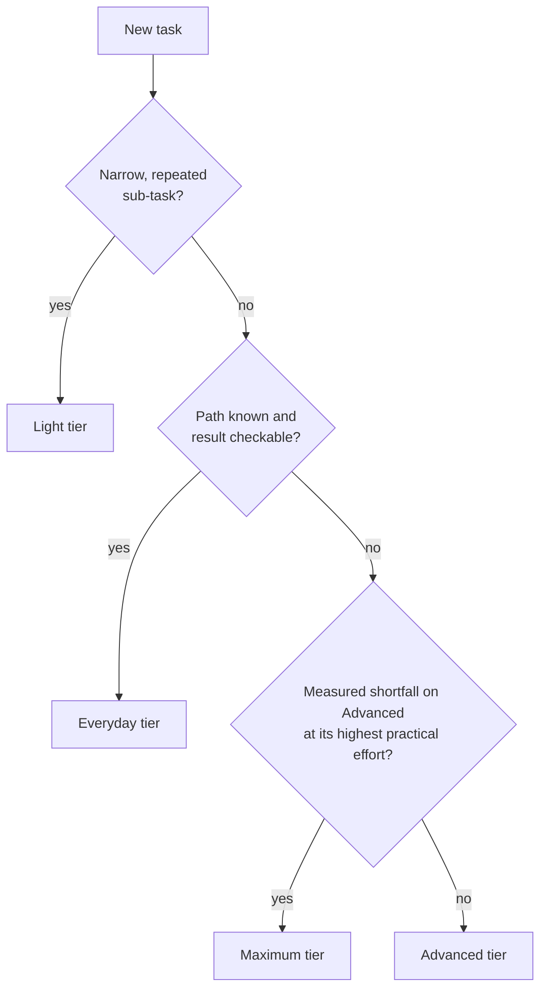

# Model selection decision guide

This chapter covers three settings that are easy to blur together: which **model** runs, how much
**effort** it applies, and which **speed** mode serves it. Current names, IDs and prices are in
[model data](model-data.md); this chapter uses tier names so it does not go stale with each
release.

## What the vendor documents

Anthropic's [choosing a model](https://platform.claude.com/docs/en/about-claude/models/choosing-a-model)
page describes two ways to pick a starting model: start with the smallest model and upgrade only
for a specific capability gap, or start with a strong model and make it cheaper later by lowering
effort or stepping down. It also says that tuning effort "is often a better lever than switching
models". The same page tells you to build tests from your own prompts and data before changing
models.

The rest of this chapter is this playbook's recommendation layered on top of that guidance,
except where a sentence names a vendor page.

## Choosing a starting model

Work through the questions in order and stop at the first "yes".

| # | Question | If yes, start with |
| --- | --- | --- |
| 1 | Is this a narrow, repeated sub-task (classify, extract, list files, check links) or a delegated worker doing simple collection? | **Light** |
| 2 | Is the path already known, and will a test, type check or build catch a wrong result? | **Everyday** |
| 3 | Do you have measurements showing the Advanced tier at its highest practical effort still falls short on this kind of work? | **Maximum** |
| 4 | Anything else: unfamiliar design, competing evidence, security reasoning, a long unattended run | **Advanced** |



Notes on the chooser:

- **When you cannot answer the questions, use your environment's default model.** At the time of
  the snapshot in [model data](model-data.md), the vendor's stated starting point and the Claude
  Code default for most accounts are both in the Advanced tier, so "no information" and
  question 4 lead to the same place.
- **Question 3 asks for a measurement, not a feeling.** "This task is important" or "this task is
  long" does not qualify. The vendor's own bar is tests at the highest effort levels of the tier
  below still falling short.
- **Compare cost per finished task, not per token.** A more capable model can finish in fewer
  turns, which offsets part of its price. Anthropic's
  [cost guide](https://platform.claude.com/docs/en/about-claude/models/optimizing-for-cost-and-intelligence)
  makes the same point and shows measurements.

## Effort

Effort is a setting within one model. Anthropic's
[cost guide](https://platform.claude.com/docs/en/about-claude/models/optimizing-for-cost-and-intelligence)
describes it as governing how much thinking, tool calling and self-verification the model does;
the parameter itself is documented on the
[effort](https://platform.claude.com/docs/en/build-with-claude/effort) page. It tracks how hard
the reasoning is. It does not track how many files are involved.

| Level | Use it when |
| --- | --- |
| `low` | The task is simple or high-volume and a wrong result is cheap to detect |
| `medium` | The task is clearly specified and a test will catch a wrong result |
| `high` | The reasoning is hard, or a wrong result would be expensive to find later |
| `xhigh` | Long, tightly coupled work where you have seen `high` fall short |
| `max` | You are measuring a model's ceiling, or a rare task where time and tokens do not matter |

The names are shared across models, but what each level does is not. Defaults differ by model and
by product surface, and the effort page notes cases where a model's levels were recalibrated
from its predecessor's or its default moved. See [model data](model-data.md) for the current
defaults, and treat a setting carried over from another model as untested.

### Calibration rules

1. **Start at the model's documented default** for the surface you are using, and set it
   explicitly so a changed default cannot move you silently.
2. **Step down when the check is strong.** If a failing result is caught by something that runs,
   try one level lower and keep it if quality holds.
3. **Step up one level at a time, on evidence.** A specific miss ("skipped the migration test",
   "stopped before the second module") is evidence. Task size is not.
4. **Consider running low and re-running the failures higher.** Anthropic's cost guide documents
   this policy for checkable work, with two conditions that both matter: you need a real failure
   signal, because a checker that passes bad work lets failures through, and each first-pass
   failure costs a second run of wall-clock time.

## Speed

Some models offer a faster serving mode at a higher price
([fast mode](https://platform.claude.com/docs/en/build-with-claude/fast-mode)). Availability
depends on the model and the platform.

- Default to standard speed.
- Choose fast when a person is waiting on each response and the premium is worth it to them.
- Fast mode changes how quickly tokens arrive. It does not add reasoning depth, so it never
  substitutes for effort, and it never changes what the session is allowed to do.

## Verify before you depend on it

Before a run card names a model, an effort level or a speed mode, confirm your environment
actually offers it.

In Claude Code:

```text
/model            show or change the session model
/effort           show or change the effort level
/effort status    show the level in force
```

On the API, the Models endpoint returns each model's limits and capabilities. This is the example
from the [API reference](https://platform.claude.com/docs/en/api/models/list); check that page
for the current version header:

```bash
curl https://api.anthropic.com/v1/models \
    -H 'anthropic-version: 2026-10-21' \
    -H "Authorization: Bearer $ANTHROPIC_API_KEY"
```

Record what you checked and when on the run card's `Checked` line. If the model you wanted is not
available, pick the nearest tier deliberately and write that down too; do not let a silent
substitution stand in for a decision. Organizations can restrict or substitute models, and Claude
Code reports the model a subagent actually ran on in `/tasks`
([subagents](https://code.claude.com/docs/en/sub-agents)).

## Mixed-model runs

When a run uses more than one model, give each role the cheapest tier that does its job:

- An orchestrating session that plans and reconciles can sit on the Advanced tier.
- Workers that read, collect or apply a mechanical change can sit one or two tiers lower.
- A reviewer should be at least as capable as the author, because its job is to catch what the
  author missed.

Before building a multi-model arrangement, measure the simpler option first: one capable model at
a lower effort level. It is one configuration to maintain instead of several.

## Common mistakes

| Mistake | What to do instead |
| --- | --- |
| Raising effort because the task touches many files | Many similar edits are a [unit of work](02-topology-and-strategy.md#unit-of-work-is-there-a-list) question |
| Moving to the top tier because a run failed once | Classify the miss first, see [fallback](07-fallback-and-escalation.md) |
| Copying last quarter's effort setting to a new model | Re-test; a level does not mean the same thing on every model |
| Writing a model ID into a long-lived policy document | Reference a tier and keep the ID in one dated place |
| Assuming a documented feature is enabled for your account | Check the environment, then record the check |
