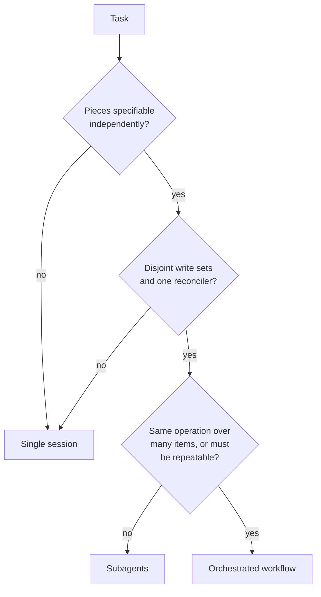

# Execution topology and strategy guide

**Topology** is how many sessions do the work and who coordinates them. **Strategy** is where a
run pauses and whether it works through a list. Both are separate from model and effort: a
stronger model does not need more agents, and more agents do not make a weak plan stronger.

## The three topologies

| | Single session | Subagents | Orchestrated workflow |
| --- | --- | --- | --- |
| What it is | One conversation does everything | The main session hands bounded tasks to workers and reads their summaries | A script runs many agents through fixed stages |
| Who holds the plan | The session | The session, turn by turn | The script |
| Pays off when | Steps share context or depend on each other | A side task is read-heavy, independent, or needs fresh eyes | The same operation repeats across many items, or the plan must be repeatable |
| Main cost | Context fills up on long tasks | Tokens, plus time for each worker to rebuild context | Many agents' worth of tokens; no input from you mid-run |

The "who holds the plan" row follows the comparison in the Claude Code
[workflows](https://code.claude.com/docs/en/workflows) documentation: with subagents the model
decides turn by turn what to spawn next, and a workflow moves the loop and the intermediate
results into a script.

**Single session is the default.** Move off it only when you can name what the extra sessions
buy.

## The independence test

Before delegating anything, answer three questions about each piece of work you would hand off.

1. **Can it be specified without another piece's result?** If piece B needs to know what piece A
   found, they are one piece.
2. **Does it write to files nobody else writes to?** Two writers on the same files is a merge
   conflict you have scheduled in advance.
3. **Is there one owner for the final reconciliation?** Someone, usually the main session, must
   compare the results against the evidence and resolve disagreements. Summaries do not merge
   themselves.

If any answer is "no", keep the work in one session, or re-cut the pieces until all three are
"yes".



## What delegation costs

The Claude Code [best practices](https://code.claude.com/docs/en/best-practices) page is direct
about this. A subagent sends its own requests against the same usage limits; a fresh one first
has to gather context your conversation already had, so it can be slower than doing the task in
place; and by default it is the same model or a smaller one. In its words: "You get parallelism
or a fresh pair of eyes out of it, but not a smarter answer."

Two more costs follow from how delegation works:

- **The handoff is lossy in both directions.** The worker knows only what the brief says, and you
  see only what the summary says.
- **Confident summaries look alike.** A worker's mistake arrives in the same tone as its
  findings. Plan to check anything you will act on.

## Subagents

Good uses, as the vendor documentation lists them:

- Running independent pieces at the same time.
- Keeping long output, such as a full test run or a wide search, out of the main context.
- Getting a reviewer that has not seen how the code was written.
- Giving a task fewer tools than the main session has, such as a read-only reviewer.

Rules for a delegated task:

- **Brief it like a colleague who just walked in.** State the goal, what is already ruled out,
  where to look, and the exact shape of the answer you want back. Use the
  [subagent brief](../templates/subagent-brief.md).
- **One writer per file set.** If two workers must edit, give each its own checkout. Claude Code
  supports this with `isolation: worktree` in a subagent definition
  ([worktrees](https://code.claude.com/docs/en/worktrees)); see
  [workspace isolation](05-workspace-isolation.md).
- **Do not delegate a lookup.** If you already know which file to read, read it.
- **Do not duplicate.** Once a task is delegated, wait for the result instead of also doing it.
- **Set the worker's model on purpose.** Collection and mechanical edits rarely need the main
  session's model. A subagent definition can name its own `model` and `effort`
  ([subagents](https://code.claude.com/docs/en/sub-agents)).
- **State a budget.** Write the number of workers and the purpose of each on the run card before
  the run. If the run needs more, that is a change of plan, not a detail.

This playbook does not prescribe a maximum number of agents. The tools enforce their own runtime
limits (the ones this playbook relies on are listed in [model data](model-data.md)), and the right budget for your team depends on your
usage plan and how much reconciliation one person can review. Pick a number and write it down.

## Orchestrated workflows

A workflow fits when the plan itself is the reusable thing: audit every handler, migrate every
file, review every changed file and write one summary. The Claude Code
[workflows](https://code.claude.com/docs/en/workflows) page lists these as typical cases and
states the trade: a run can use meaningfully more tokens than doing the same
task in conversation, and it takes no input from you mid-run.

Recommendations:

- **Pilot on a small slice.** The workflows page suggests running one directory instead of
  the whole repository to gauge spend. Treat the pilot as part of the plan, and review its output
  before launching the full run.
- **Read the plan before approving it.** The approval prompt shows the planned phases and offers
  the raw script.
- **Put a verification stage in the script.** A fan-out without a check stage produces a large
  amount of unverified work.
- **Split at sign-off points.** A run does not pause for approval between stages, so if a human
  must approve the result of stage one, make stage two a separate run.
- **Ask for a workflow per task, not per session.** Claude Code also has a session-wide switch
  for orchestration. The workflows page says that with it on, a workflow is planned for each
  substantive task, so each request uses more tokens and takes longer, and it advises turning
  the switch off when you return to routine work.

On the run card, record the stages, the worker model, and the pilot result.

## Execution strategy

Inside one session, two things are worth deciding in advance. They are independent of each
other, and most tasks need neither.

### Checkpoints: where does the run pause?

A checkpoint is a named point where the session stops, shows evidence, and waits, either for a
check to pass or for you.

| Use | When |
| --- | --- |
| No checkpoints (default) | A mistake would be caught by the final checks and is cheap to undo |
| Approve the plan first | The approach is open, or you want to see the route before any file changes |
| Pause at named points | A later step should not happen unless an earlier one worked, such as running a data migration before switching code to use it |

For "approve the plan first", Claude Code has a mode for it. The
[permission modes](https://code.claude.com/docs/en/permission-modes) page describes plan mode as
telling the model to research and propose changes without making them; edits begin when you
approve the plan.

For named points, write them into the prompt as conditions with evidence: "after the migration
is written, show it applying and rolling back on the test database, then wait". A checkpoint
without stated evidence is only a pause.

### Unit of work: is there a list?

Some tasks are one piece of work. Others are the same small piece of work many times: the same
edit at each call site, the same fix in each module.

| Use | When |
| --- | --- |
| The whole task (default) | The work is one connected change |
| One item at a time | The items are alike, do not depend on each other, and each has its own check |

When there is a list, say what the item is, what check applies to each one, and ask for the
result per item. The report should let you point at the items that failed. If the list is long
and the items are truly independent, that is also the case for a
[workflow](#orchestrated-workflows); the item loop is the single-session version of the same
idea.

### Order of tool calls

You rarely need to say anything about this. Anthropic's
[prompting best practices](https://platform.claude.com/docs/en/build-with-claude/prompt-engineering/claude-prompting-best-practices)
note that current models run independent tool calls in parallel by default, for example reading
several files at once, and that the behaviour can be steered from the prompt. If an order
matters for a reason the model cannot see, state the order and the reason.

## Recording the decision

```text
Topology:      subagents (2: one maps call sites read-only; one reviews the final diff)
Checkpoints:   none
Unit of work:  each call site, checked by the type checker and that file's tests
```

A reader should be able to tell from those lines how many sessions ran, what each was for, where
the run paused, and what was checked item by item.
